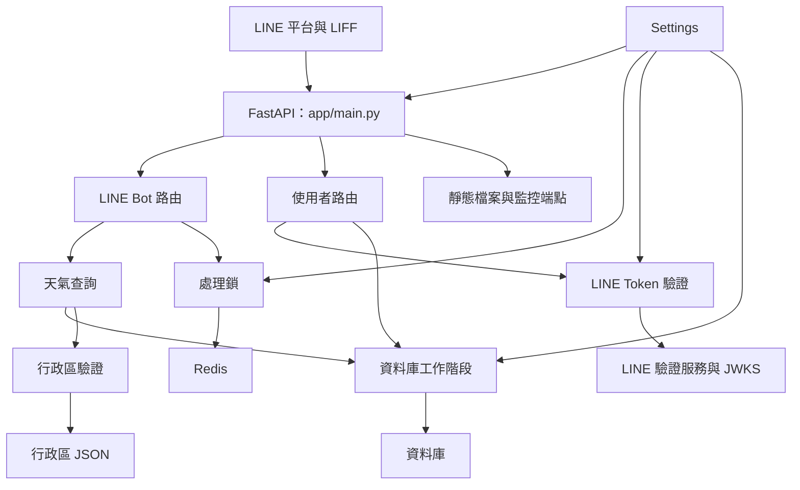
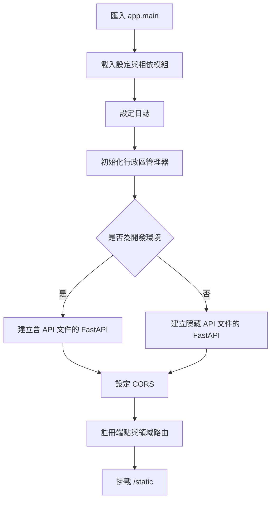
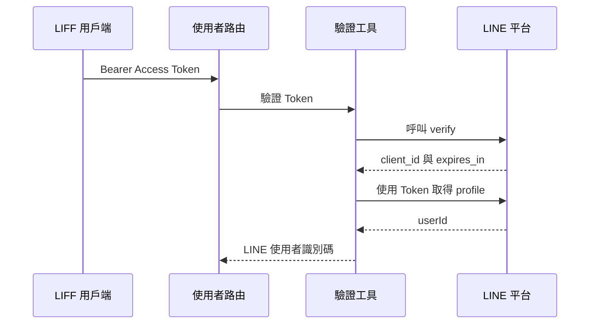
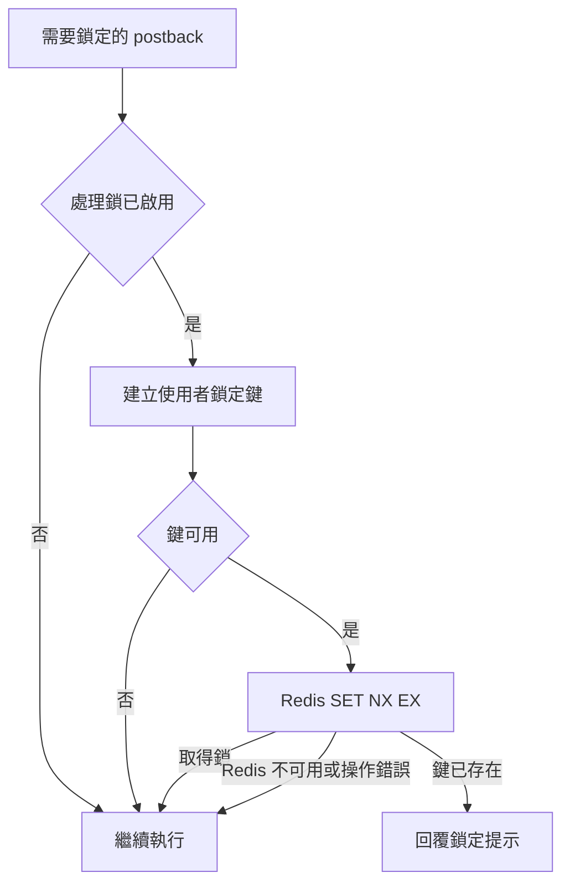

# 應用程式核心

`application_core` 提供 WeaMind FastAPI 應用程式的入口與共用基礎設施：設定、記錄、資料庫工作階段、LINE 身分驗證、臺灣行政區資料及 Redis 處理鎖。它將使用者 API 與 LINE Bot 路由接到應用程式；天氣查詢及使用者資料的領域邏輯則由各自模組負責。

## 架構與系統位置

- [LINE Bot](line_bot.md) 處理 webhook、事件與回覆；需要鎖定的 postback 會使用核心處理鎖。
- [使用者與位置設定](users_and_location_settings.md) 使用 Access Token 依賴項及資料庫工作階段。
- [天氣查詢](weather_queries.md) 使用資料庫與行政區驗證；資料表模型也繼承核心 `Base`。
- [資料庫遷移](database_migrations.md) 使用 `Base` 的模型中繼資料；建置與執行環境見[建置、部署與設定](build_deployment_and_configuration.md)。

## 入口與啟動

`app/__init__.py` 與 `app/core/__init__.py` 定義套件及其用途；`app/main.py` 建立並組裝應用程式。匯入入口模組時，程式先執行 `setup_logging()` 和 `initialize_admin_divisions()`，再建立 FastAPI 實例、加入 CORS、註冊路由及掛載靜態檔案。行政區管理器在其模組匯入時即建立，入口的初始化呼叫再次取得同一個實例。

`ENV` 為 `development` 或 `dev` 時保留預設 API 文件；其他值皆停用 `/docs`、`/redoc` 及 OpenAPI 文件。CORS 僅允許來源 `https://liff.line.me`，允許憑證、`GET`、`POST` 與所有請求標頭。

| 入口 | 行為 |
| --- | --- |
| `GET /` | 回傳歡迎訊息。 |
| `GET /health` | 回傳 `{"status": "ok"}`，可供存活及就緒探針使用；不檢查資料庫、Redis 或外部服務。 |
| `GET /metrics` | 由 `app.line.metrics.metrics_response()` 提供 Prometheus 指標。 |
| `/static` | 從工作目錄下的 `static` 提供靜態檔案，包括 LIFF 資源。 |

## 設定與日誌

`app/core/config.py` 的 `Settings` 使用 Pydantic Settings，從環境及 `.env` 載入設定，忽略未宣告的欄位；模組匯入時建立全域 `settings`。下表列出核心行為所需的設定。

| 設定 | 用途與預設值 |
| --- | --- |
| `APP_NAME`、`DEBUG`、`ENV` | 應用程式名稱預設為 `WeaMind API`；`DEBUG=False`、`ENV=development`。環境名稱比較不區分大小寫。 |
| `POSTGRES_USER`、`POSTGRES_PASSWORD`、`POSTGRES_HOST`、`POSTGRES_DB`、`POSTGRES_PORT` | PostgreSQL 連線參數；連接埠預設 `5432`，前四項必填。 |
| `DATABASE_URL` | 可覆寫組合產生的 `postgresql+psycopg` URL；即使設定此值，模型仍宣告上述四個 PostgreSQL 欄位為必填。 |
| `LINE_CHANNEL_SECRET`、`LINE_CHANNEL_ACCESS_TOKEN` | LINE Bot 憑證，均為必填。 |
| `LINE_CHANNEL_ID`、`ENABLE_ID_TOKEN_SIGNATURE_VERIFICATION` | ID Token 的 audience 與簽章驗證開關；前者預設為 `None`，後者預設為 `True`。 |
| `BASE_URL` | 應用程式網址，預設 `https://api.kyomind.tw`。 |
| `PROCESSING_LOCK_ENABLED`、`PROCESSING_LOCK_TTL_SECONDS`、`REDIS_URL` | 處理鎖預設啟用、TTL 為 1 秒，Redis 預設 `redis://redis:6379/0`。 |

`setup_logging()` 建立專案根目錄下的 `logs`，同時輸出至標準輸出及 `logs/app.log`。`DEBUG=True` 或正式環境的根記錄層級為 `DEBUG`，其餘為 `INFO`；SQLAlchemy engine 在 `DEBUG=True` 時為 `INFO`，否則為 `WARNING`。Uvicorn 與其 access logger 設為 `INFO`，並加入檔案 handler。

例如，`docker-compose.yml` 將 `.env` 提供給 app 並宣告 db、redis；`docker-compose.prod.yml` 設定 `ENV=production`、兩個 Uvicorn worker 及日誌目錄掛載。容器工作目錄與程式碼複製方式見 `Dockerfile`。各 worker 的記憶體快取各自獨立，Redis 鎖則可跨行程共享。

## 資料庫連線與工作階段

`app/core/database.py` 從 `settings.database_url` 建立 SQLAlchemy `engine` 與 `SessionLocal`。SQLite URL 額外使用 `check_same_thread=False` 及 `StaticPool`；其他 URL 使用一般引擎設定。`Base` 是 ORM 模型共用的 `DeclarativeBase`，供使用者與天氣模型及遷移中繼資料使用。

`get_session()` 是 FastAPI 依賴項：建立 session、交給路由使用，最後在 `finally` 關閉。它本身不執行 commit 或 rollback；其他呼叫端也可直接使用 `SessionLocal`，並須管理自己的工作階段生命週期。

## LINE 身分驗證

`app/core/auth.py` 提供兩條 Token 驗證路徑與對應的 Bearer 依賴項。目前 `POST /users/locations` 使用 `get_current_line_user_id_from_access_token`；`get_current_line_user_id` 則包裝舊版 ID Token 驗證。

- **Access Token**：先呼叫 LINE `/oauth2/v2.1/verify`，要求成功回應、存在 `client_id` 且 `expires_in > 0`；程式僅檢查 `client_id` 存在，沒有與設定值比較。接著呼叫 `/v2/profile` 取得 `userId`。網路錯誤回傳 HTTP 503，其他驗證或回應錯誤回傳 HTTP 401。
- **ID Token**：檢查三段格式及 `RS256`／`ES256` 演算法，再以 LINE JWKS 公鑰驗證簽章及 issuer；設定 `LINE_CHANNEL_ID` 時也驗證 audience。時間檢查容許 300 秒誤差，並要求 `sub`。正式環境若停用簽章驗證或未設定 `LINE_CHANNEL_ID`，回傳 HTTP 500。
- **開發用輕量驗證**：停用簽章驗證時仍檢查格式、演算法、`exp`、issuer、選用的 audience 與 `sub`，但不驗證簽章；正式環境禁止此路徑。
- **JWKS 快取**：記憶體快取 TTL 為 24 小時；找不到 `kid` 時強制重新取得一次。網路連線錯誤且已有快取時可使用過期資料，無快取時回傳 HTTP 503；未知 `kid` 回傳 HTTP 401。無效 JWKS 回應或無法解析公鑰回傳 HTTP 503。`_base64url_decode_nopad()` 負責補齊 padding 後解碼 JWT 資料。

## 臺灣行政區

`AdminDivisionsManager` 是行程內單例，從 `static/data/tw_admin_divisions.json` 讀取縣市到鄉鎮市區的對應，將每個縣市與區名串接成集合，例如 `臺北市信義區`。`is_valid_taiwan_division()` 執行精確集合查詢，`get_valid_divisions_count()` 回傳載入數量。

檔案不存在或讀取、解析失敗時會記錄錯誤並使用空集合，因此驗證皆為 `False`，應用程式仍可繼續啟動。初始化呼叫不會重新載入已設為空集合的單例；更換資料後需重新啟動應用程式。天氣查詢的地址解析會先將「台」正規化為「臺」，驗證後再查詢資料庫中的地點；詳細解析流程見[天氣查詢](weather_queries.md)。

## Redis 處理鎖

`ProcessingLockService` 延遲建立並重用 Redis client，首次連線時以 `ping` 測試。`build_lock_key()` 從 LINE 事件來源取出 `user_id`，產生 `processing:user:{user_id}`；沒有識別碼時回傳 `None`。目前 LINE postback 處理只對 `plan.requires_lock` 的操作使用此機制。

鎖以 `SET key 1 EX TTL NX` 原子取得，靠 TTL 自動到期，沒有手動釋放。因此 TTL 是抑制短時間重複請求的時間窗，不保證涵蓋整個處理時間。停用鎖、未設定 Redis URL 或 Redis 連線／操作錯誤時採取 fail-open，允許處理繼續，代價是可能重複處理。更多事件與回覆行為見 [LINE Bot](line_bot.md)。

## 維護重點

- 修改設定或部署環境時，核對必要環境變數、資料庫 URL、Redis URL 與 `static`、`logs` 路徑；容器細節見[建置、部署與設定](build_deployment_and_configuration.md)。
- 正式環境使用 ID Token 時，應保持簽章驗證啟用並設定 `LINE_CHANNEL_ID`；JWKS 與行政區資料是行程內狀態，多 worker 間不共享。
