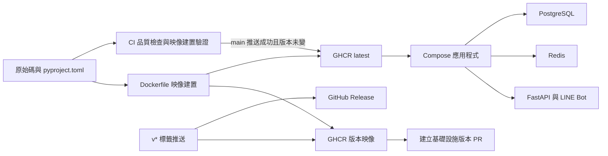
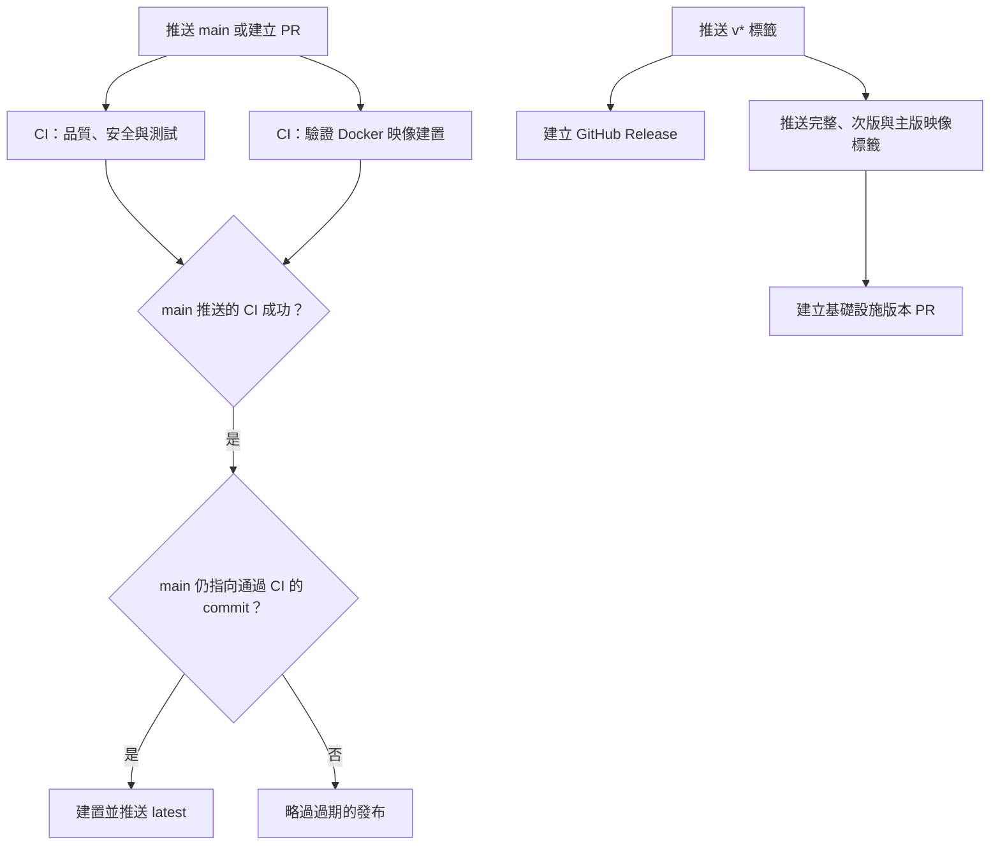

# 建置、部署與設定

本模組涵蓋 WeaMind 的 Python 相依套件、容器映像、Compose 環境、品質與安全檢查，以及 GitHub Actions 發布流程。應用程式本身的啟動與設定詳見[應用程式核心](application_core.md)，資料庫結構變更詳見[資料庫遷移](database_migrations.md)。

## 架構概覽

`pyproject.toml` 定義 Python 3.12 以上的套件需求及開發工具設定，`uv.lock` 固定解析結果。Dockerfile 使用 uv Python 3.12 映像，以 `uv sync --locked --no-dev` 安裝執行時相依套件，再複製專案內容；實際啟動命令由 Compose 指定。應用程式功能分別見 [LINE Bot](line_bot.md)、[使用者與地點設定](users_and_location_settings.md)及[天氣查詢](weather_queries.md)。

## 主要部分

- **[容器與部署](build_deployment_and_configuration/build_deployment_and_configuration_containers.md)**：`Dockerfile`、`docker-compose.yml` 與環境覆寫檔定義映像、服務、網路與持久化儲存；`Makefile` 提供操作入口。
- **[持續整合與發布](build_deployment_and_configuration/build_deployment_and_configuration_automation.md)**：`.github/workflows/` 包含 CI、CodeQL、映像發布、GitHub Release、Pages 與定期稽核工作流程。
- **[依賴與品質設定](build_deployment_and_configuration/build_deployment_and_configuration_quality.md)**：`pyproject.toml`、`.pre-commit-config.yaml`、`bandit.yaml`、`.github/dependabot.yml` 和 `skills-lock.json` 記錄相依套件、檢查規則或工具來源。
- **遷移與維運**：`alembic.ini` 指向 `migrations`，`Makefile` 將遷移及其他任務接到容器命令或腳本；腳本內容見[維運與開發腳本](operational_and_development_scripts.md)。

## 容器與環境

`docker-compose.yml` 定義 `app`、`db`、`redis`，三者加入外部網路 `wea-net`；`app` 與 `db` 從 `.env` 讀取環境變數。基底設定使用 `ghcr.io/kyomind/weamind:latest`、PostgreSQL 17.5 與 Redis 8.2.8，並對外映射應用程式的 8000 埠及 PostgreSQL 的 5433 埠。

開發覆寫檔以 `--reload` 啟動 Uvicorn，掛載原始碼和日誌，另用具名 volume 隔離容器內的 `.venv`。正式環境覆寫檔設定兩個 worker、`uvloop`、`httptools`、`--proxy-headers` 和自動重啟，資料庫與 Redis 使用外部 volumes；Redis 繫結至 `10.0.0.2:6379`。參見 `docker-compose.dev.yml`、`docker-compose.prod.yml`。

`make dev-up` 建立並啟動開發組合；`make clean` 會連同開發組合的 volumes 一起移除。正式環境的 `make setup-prod` 建立 PostgreSQL volume 和網路，但正式 Redis 外部 volume 仍須事先存在。`make up` 以前景模式啟動正式組合，`make down` 停止並移除容器。

`make deploy` 拉取 app 映像、啟動正式組合，等待 PostgreSQL 就緒，再執行 `alembic upgrade head`。遷移失敗時此目標只印出警告，仍會印出部署完成訊息；應另行檢查遷移結果。此外，其後的 `docker compose exec` 未明列覆寫檔，實際作用的 Compose 專案與設定取決於執行環境。詳見 `Makefile` 和[資料庫遷移](database_migrations.md)。

## 建置與發布流程

`.github/workflows/ci.yml` 在推送或 PR 指向 `main` 時執行：一個 job 執行 Ruff、Pyright、Bandit、pip-audit、測試與 coverage 上傳，另一個 job 只驗證 Docker 建置。Ruff 步驟使用 `--fix` 與格式化命令；它們會修改 runner 的工作樹，並非單純檢查格式。Dependabot PR 跳過 Codecov 上傳。

`.github/workflows/publish-ghcr.yml` 監聽完成的 CI，只接受成功的 `main` push，並確認 checkout 的 `main` 仍等於通過 CI 的 commit，才推送多架構 `latest`。推送 `v*` 時，`auto-release.yml` 建立 GitHub Release，`publish-release.yml` 獨立建置並推送完整、次版、主版標籤，再呼叫 `scripts/open_infra_version_pr.sh`；兩個工作流程由同一事件觸發，沒有彼此等待的設定。腳本細節見[版本與發布管理](operational_and_development_scripts/release_and_version_management.md)。

## 品質、安全與其他設定

- `.pre-commit-config.yaml` 設定一般檔案檢查、Ruff、uv lock、detect-secrets 及本機 Pyright，Bandit 在 pre-push 階段執行。CI 另依 `bandit.yaml` 掃描 `app`，並以 pip-audit 檢查相依套件。
- `.github/dependabot.yml` 每週檢查 pip 與 GitHub Actions，兩類各最多開啟五個 PR。`.github/workflows/check-pip-audit-ignores.yml` 每週或手動執行忽略項目檢查；實作見[依賴安全稽核](operational_and_development_scripts/dependency_security_audit.md)。
- `.github/workflows/codeql.yml` 在 `main` push、PR 及每週排程分析 Actions 和 Python。`.github/workflows/pages.yml` 在 `docs/site/**` 變更推送至 `main` 或手動觸發時，只部署 `docs/site/`。
- `alembic.ini` 指定遷移目錄和日誌，資料庫 URL 未在該檔中設定。`skills-lock.json` 記錄 agent skills 的來源、路徑和雜湊。
- `Makefile` 也包裝 worktree、分支清理、文件、版本、安全掃描與 LINE Rich Menu 操作；各腳本職責見[維運與開發腳本](operational_and_development_scripts.md)。
