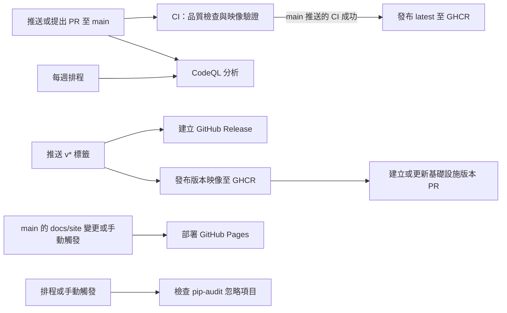
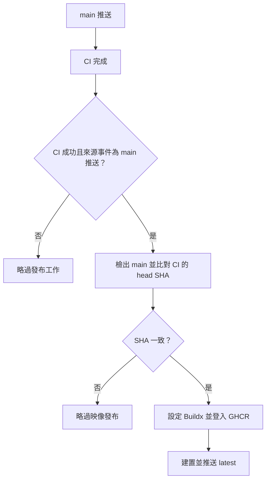
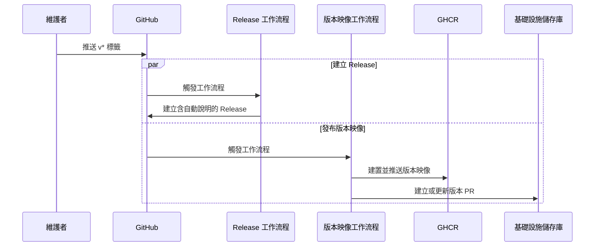

# 建置、部署與設定自動化

本模組透過 GitHub Actions 驗證 WeaMind 程式碼、掃描安全問題、發布容器映像與 GitHub Release，並部署架構圖至 GitHub Pages。工作流程以 GitHub 事件或排程為入口，串接專案的依賴設定、Dockerfile 與維運腳本；發布映像或提出基礎設施版本更新，並不代表應用程式已部署至執行環境。

整體設定見[建置、部署與設定](../build_deployment_and_configuration.md)，品質工具設定見[品質管理](build_deployment_and_configuration_quality.md)，容器建置與執行方式見[容器與部署](build_deployment_and_configuration_containers.md)。

## 架構與事件

| 工作流程與來源 | 觸發條件 | 主要產物或效果 |
| --- | --- | --- |
| `CI`：`.github/workflows/ci.yml` | 推送至 `main`，或以 `main` 為目標的 PR | 品質與測試結果、Codecov 覆蓋率，以及僅供驗證的本機映像 |
| `CodeQL`：`.github/workflows/codeql.yml` | 同上，另於每週日 00:00 UTC 執行 | `actions` 與 `python` 安全分析結果 |
| `Publish to GHCR`：`.github/workflows/publish-ghcr.yml` | `main` 的 `CI` 完成後，符合條件才執行工作 | 多平台 `latest` 映像 |
| `Auto Release`：`.github/workflows/auto-release.yml` | 推送符合 `v*` 的標籤 | 含自動產生說明的 GitHub Release |
| `Publish Release to GHCR`：`.github/workflows/publish-release.yml` | 推送符合 `v*` 的標籤 | 多平台版本映像，以及基礎設施版本 PR |
| `Deploy diagram to Pages`：`.github/workflows/pages.yml` | `main` 的 `docs/site/**` 變更，或手動觸發 | 發布 `docs/site/` |
| `Check pip-audit ignores`：`.github/workflows/check-pip-audit-ignores.yml` | 每週一 03:00 UTC，或手動觸發 | 已忽略弱點公告的狀態報告 |

## 持續整合與安全檢查

`CI` 包含兩個沒有相互依賴設定的工作，可各自執行：

1. `code-quality-check` 在 `ghcr.io/astral-sh/uv:python3.12-bookworm-slim` 容器執行 `uv sync --locked`，安裝 Git、curl、GnuPG、libatomic1 與 Node.js，再依序執行 Ruff、Pyright、Bandit、pip-audit 與 pytest。測試輸出終端機覆蓋率與 `coverage.xml`。
2. `docker-build-validate` 使用 Docker Buildx，從 `Dockerfile` 建置並載入標記為 `weamind-ci-test:${{ github.sha }}` 的映像；此步驟不推送映像。

Ruff 命令包含 `--fix`，格式化也會修改 runner 工作目錄；工作流程沒有將這些修改提交回儲存庫的步驟。除 Dependabot 發起的 PR 外，測試後會以 `CODECOV_TOKEN` 上傳覆蓋率，且上傳錯誤會使 CI 失敗。依賴、工具與覆蓋率設定位於 `pyproject.toml`，Bandit 使用 `bandit.yaml`。

`CodeQL` 的 `analyze` 以矩陣分別掃描 `actions` 與 `python`，兩者均使用 `build-mode: none`，並啟用 `security-extended,security-and-quality` 查詢。設定檔 `.github/codeql/codeql-config.yml` 排除 migrations 路徑；矩陣設定 `fail-fast: false`，單一分析失敗不會取消其他矩陣項目。

`Check pip-audit ignores` 執行 `scripts/check_pip_audit_ignores.py`，使用 `GITHUB_TOKEN` 查詢 GitHub Advisory API。腳本尋找儲存庫中的 GHSA 忽略項目；公告已撤回或有修補版本時回報並以非零狀態結束。它提示維護者檢查，不會自動更新依賴或移除忽略項目。詳細邏輯見[依賴安全稽核](../operational_and_development_scripts/dependency_security_audit.md)。

## main 映像發布流程

`publish-ghcr.yml` 以 `workflow_run` 監聽名稱完全為 `CI` 的工作流程。即使監聽到完成事件，只有結論為成功、來源事件為 `push` 且來源分支為 `main`，`build-and-push` 才會執行。工作檢出當下的 `main`，將其 SHA 與通過 CI 的 `head_sha` 比對；若期間 `main` 已前進，就正常結束比對步驟並跳過後續發布步驟。

符合條件時，Buildx 使用 `Dockerfile` 建置 `linux/amd64` 與 `linux/arm64`，推送 `ghcr.io/${{ github.repository_owner }}/weamind:latest`，並使用 GitHub Actions 快取。此流程重新建置映像；CI 的驗證映像並未被直接推送。映像內容與依賴分層見[容器與部署](build_deployment_and_configuration_containers.md)。

## 版本發布與基礎設施交接

兩個工作流程由同一標籤推送獨立觸發，沒有設定彼此等待，也沒有設定等待 CI。Release 工作流程取得完整 Git 歷史，使用自動產生的發行說明。版本映像工作流程先取得完整歷史、登入 GHCR，將標籤去除 `v` 後按句點切出完整版本、次版本及主版本；例如 `v1.2.3` 產生 `1.2.3`、`1.2`、`1` 三個映像標籤。觸發條件只限定 `v*`，版本擷取本身沒有驗證語意化版本格式。`latest` 由前述 main 流程管理。

版本映像推送成功後，工作流程將完整版本傳給 `scripts/open_infra_version_pr.sh`。腳本使用 `WEAMIND_INFRA_PR_TOKEN` 作為 `GH_TOKEN`，複製 `kyomind/weamind-infra` 的 `main`，更新 `manifests/deployment.yaml` 中 `ghcr.io/kyomind/weamind` 的映像標籤，推送 `bump-weamind-<version>` 分支，並建立或更新對應 PR。若檔案沒有變更，則略過 PR。這是變更提案；合併、部署與執行環境狀態不由此工作流程保證。腳本細節見[發布與版本管理](../operational_and_development_scripts/release_and_version_management.md)。

## GitHub Pages

`.github/workflows/pages.yml` 將 `docs/site/` 上傳為 Pages artifact，再部署至 `github-pages` 環境；其他 `docs/` 內容不包含在此發布範圍。推送觸發受 `docs/site/**` 路徑限制，亦可手動執行。所有執行共用 `pages` concurrency 群組，新的執行會取消進行中的同群組執行；部署網址取自部署步驟的 `page_url` 輸出。

## 權限、憑證與維護重點

| 工作流程 | 權限或憑證 | 用途 |
| --- | --- | --- |
| CI | `contents: read`、`CODECOV_TOKEN` | 讀取原始碼及上傳覆蓋率 |
| CodeQL | `security-events: write`、`packages: read`、`actions: read`、`contents: read` | 執行分析並寫入安全事件 |
| Auto Release | `contents: write`、`GITHUB_TOKEN` | 建立 GitHub Release |
| 兩個 GHCR 發布流程 | `contents: read`、`packages: write`、`GITHUB_TOKEN` | 讀取原始碼及推送映像 |
| 版本映像流程 | `WEAMIND_INFRA_PR_TOKEN` | 對基礎設施儲存庫推送分支及建立或更新 PR |
| Pages | `contents: read`、`pages: write`、`id-token: write` | 上傳並部署 Pages |
| 忽略項目檢查 | `contents: read`、`github.token` | 讀取儲存庫並查詢公告 |

維護時應確認 `publish-ghcr.yml` 監聽的名稱與 `ci.yml` 的 `name: CI` 一致。若 `latest` 未更新，先檢查 CI 結論、來源事件及 SHA 比對紀錄；若版本映像已推送但基礎設施 PR 步驟失敗，映像推送仍可能已完成，應分別檢查 GHCR 與工作流程日誌。GitHub Release、映像發布與 Pages 的成功狀態各自獨立。
