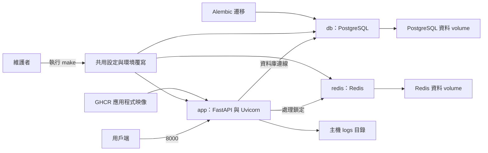
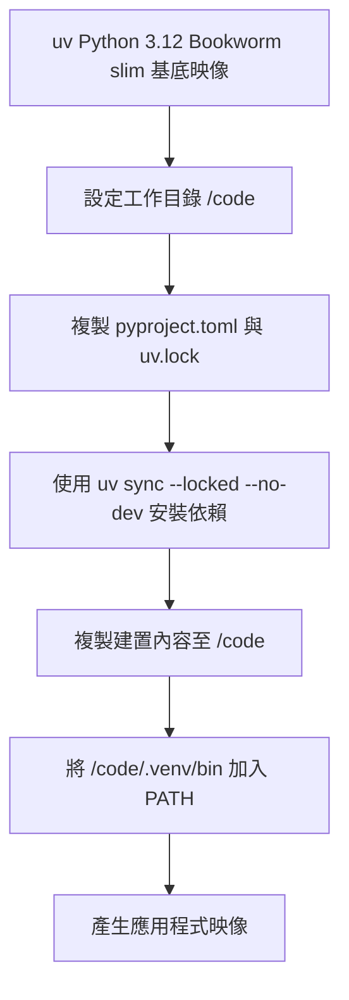
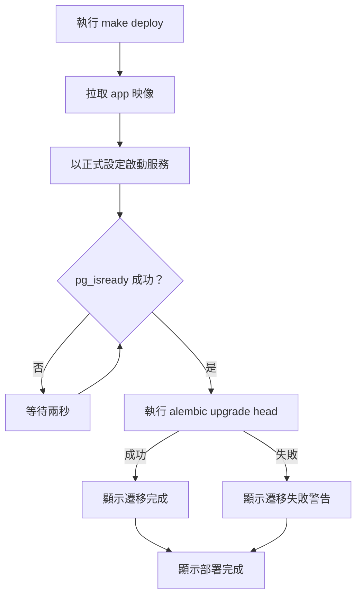

# 容器建置、部署與設定

本模組以 `Dockerfile` 建立 WeaMind 應用程式映像，透過共用 Compose 設定與環境覆寫檔組合 `app`、PostgreSQL 和 Redis，並由 `Makefile` 提供部署及遷移入口。本頁描述儲存庫中的 Compose 設定；應用程式行為見[應用程式核心](../application_core.md)、[LINE Bot](../line_bot.md)及[天氣查詢](../weather_queries.md)。

## 架構與元件

三個服務使用外部網路 `wea-net`。共用設定的 `app` 以 `depends_on` 宣告依賴 `db` 和 `redis`，但沒有服務健康檢查或等待依賴就緒的條件。`app` 的 `8000` 和 PostgreSQL 的 `5432` 分別發布至主機 `8000` 和 `5433`；正式覆寫檔另將 Redis 的 `6379` 綁定至主機 `10.0.0.2:6379`。實際可達性仍取決於主機與網路設定。

| 檔案 | 職責 |
| --- | --- |
| `Dockerfile` | 定義 Python 執行環境、依賴安裝與應用程式映像。 |
| `docker-compose.yml` | 定義共用映像、服務、連接埠、`.env` 與網路。 |
| `docker-compose.dev.yml` | 設定開發命令、原始碼掛載及開發 volume。 |
| `docker-compose.prod.yml` | 設定正式命令、重新啟動政策及外部資料 volume。 |
| `Makefile` | 包裝 Compose、Alembic 和其他維護命令。 |
| `alembic.ini` | 指定遷移腳本位置、匯入路徑及日誌設定。 |

## 映像建置

`Dockerfile` 使用 `ghcr.io/astral-sh/uv:python3.12-bookworm-slim`，設定 `UV_COMPILE_BYTECODE=1` 與 `UV_LINK_MODE=copy`，並在安裝依賴時使用 `/root/.cache/uv` 建置快取。先複製 `pyproject.toml` 和 `uv.lock`，再複製程式碼，有助於程式碼變更時重用依賴層。`.dockerignore` 排除本機 `.venv`、`.env` 和測試目錄等內容；執行時設定需另外提供。映像清空 `ENTRYPOINT`，由 Compose 覆寫檔提供 Uvicorn 啟動命令。

共用 Compose 檔指定 `ghcr.io/kyomind/weamind:latest`，沒有定義 `build`。因此 `make dev-up` 和 `make up` 雖帶有 `--build`，這份設定並未指定從本機 `Dockerfile` 建置 `app`；需要本機映像時，應明確建置並確認使用的標籤。`.github/workflows/ci.yml` 驗證 Docker 建置，`.github/workflows/publish-ghcr.yml` 在符合條件時建置並發布 `latest`；觸發條件與版本發布見[自動化流程](build_deployment_and_configuration_automation.md)。

## 環境與資料

`docker-compose.yml` 將 `.env` 載入 `app` 和 `db`；覆寫檔的 `environment` 將 `ENV` 分別設為 `development` 和 `production`。應用程式的 `Settings` 使用 PostgreSQL、LINE 和 Redis 等設定，例如 `REDIS_URL` 預設為 `redis://redis:6379/0`；完整欄位見[應用程式核心](../application_core.md)。請準備符合實際服務的 `.env`，並保護其中的憑證。

| 項目 | 開發環境 | 正式環境 |
| --- | --- | --- |
| 啟動參數 | `uvicorn app.main:app --host 0.0.0.0 --port 8000 --reload` | `uvicorn app.main:app --host 0.0.0.0 --port 8000 --workers 2 --proxy-headers --loop uvloop --http httptools` |
| 程式碼 | `.:/code` 綁定主機原始碼 | 使用映像內程式碼 |
| 虛擬環境 | `app-venv-dev:/code/.venv`，避免主機虛擬環境覆蓋容器環境 | 使用映像內的 `/code/.venv` |
| 日誌 | `./logs:/code/logs` | `./logs:/code/logs` |
| PostgreSQL | `wea-db-data-dev` | 外部 volume `wea-db-data-prod` |
| Redis | `wea-redis-data-dev` | 外部 volume `wea-redis-data-prod` |
| 容器名稱 | `wea-app-dev`、`wea-db-dev`、`wea-redis-dev` | `wea-app-prod`、`wea-db-prod`、`wea-redis-prod` |
| 重新啟動政策 | 未在這些 Compose 檔指定 | 三個服務均為 `always` |

資料 volume 在容器中的掛載位置分別為 PostgreSQL 的 `/var/lib/postgresql/data` 與 Redis 的 `/data`。具名 volume 保留容器以外的資料，但 Redis 資料實際持久化方式仍取決於 Redis 本身的設定。

## 操作流程

下列命令從儲存庫根目錄執行。兩個環境都需要預先存在的外部網路 `wea-net`，可用 `docker network create wea-net` 建立。正式環境另需外部 volume `wea-db-data-prod` 和 `wea-redis-data-prod`。`make setup-prod` 只建立前者與網路，後者需另以 `docker volume create wea-redis-data-prod` 建立。

### 開發環境

- `make dev-up`：合併共用與開發設定，在背景啟動服務。
- `make clean`：以開發設定執行 `down -v`，移除 Compose 管理的開發 volume，包括資料庫、Redis 資料和容器虛擬環境；執行前應確認資料不再需要。
- 原始碼透過綁定掛載供 `--reload` 使用；依賴變更時，應確認容器內具名虛擬環境的內容也已更新。

### 正式環境

- `make up`：合併共用與正式設定，在前景啟動服務。
- `make down`：停止並移除正式 Compose 服務；外部 volume 由 Compose 以外管理。
- `make deploy`：拉取 `app` 映像、背景啟動服務、等待 PostgreSQL，然後嘗試升級遷移。

`pg_isready` 使用 `wea_bot` 和 `weamind`，迴圈沒有逾時。遷移失敗時，`Makefile` 顯示警告後仍會印出「部署完成」，應檢查遷移輸出及服務狀態。等待資料庫和執行遷移的 `docker compose exec` 沒有指定 `-f` 覆寫檔；獨立的遷移命令也是如此，使用時應確認 Compose 專案與設定選取指向預期的執行中服務。

## 資料庫遷移

`alembic.ini` 將 `script_location` 設為 `%(here)s/migrations`，並以 `prepend_sys_path = .` 加入匯入路徑。`migrations/env.py` 載入模型的 `Base.metadata`，依 `POSTGRES_USER`、`POSTGRES_PASSWORD`、`POSTGRES_HOST`、`POSTGRES_DB` 組合連線 URL；此處未使用 `Settings.database_url` 的 `DATABASE_URL` 或 `POSTGRES_PORT`。遷移內容與版本關係見[資料庫遷移](../database_migrations.md)。

| 命令 | 行為 |
| --- | --- |
| `make migrate` | 在 `app` 容器執行 `uv run alembic upgrade head`。 |
| `make revision` | 使用 `--autogenerate` 產生 revision，訊息包含目前 Git 分支與時間；產生後仍需檢查內容。 |
| `make rollback` | 執行 `uv run alembic downgrade -1`，回退一個 revision。 |

## 其他 Makefile 入口

`upgrade-pyright` 更新鎖定檔中的 `pyright` 並同步依賴；`security-bandit`、`security-audit`、`security-all` 執行安全掃描。品質工具設定見[品質與依賴設定](build_deployment_and_configuration_quality.md)。

`tree`、`check`、`prune`、`export-docs`、`clean-docs`、`worktree-add`、`worktree-list`、`worktree-remove`、`worktree-clean`、`update-liff-version`、`update-static-version`、`changelog-status`、`changelog-prepare`、`changelog-release`、`changelog-help` 及 `upload`、`upload-list`、`upload-delete` 包裝各自的維護腳本或工具；其中 `check` 預覽本機分支清理，`prune` 執行清理。`changelog-prepare` 和 `changelog-release` 接受 `VERSION`，`upload` 需要 `IMAGE`，`upload-delete` 需要 `ID`。腳本行為見[操作與開發腳本](../operational_and_development_scripts.md)。

整體建置與部署設定的導覽見[建置、部署與設定](../build_deployment_and_configuration.md)。
