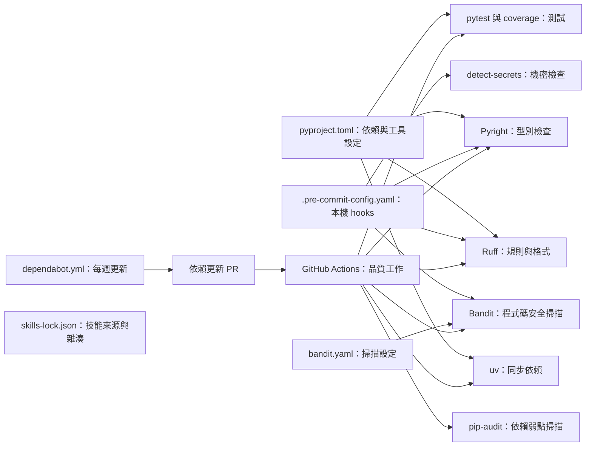
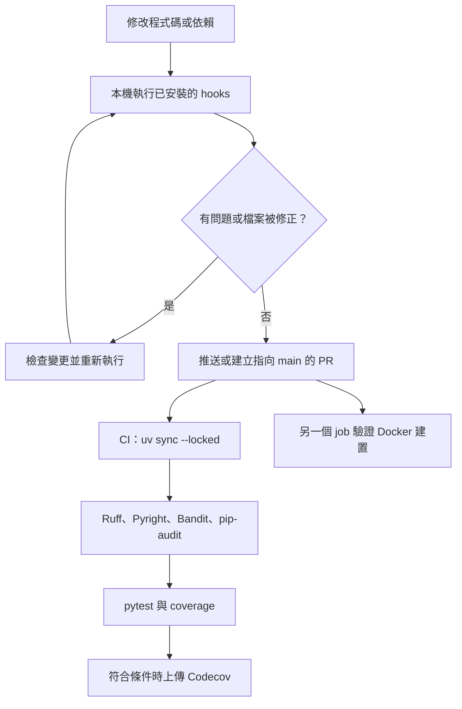

# 依賴管理與程式碼品質

本模組集中定義 WeaMind 的 Python 依賴、開發工具規則、安全掃描、Git hooks 與依賴更新設定。這些設定供開發者本機和 GitHub Actions 使用，支援應用程式的開發與驗證；它們本身不處理 LINE 請求或天氣查詢。整體建置與部署脈絡見[建置、部署與設定](../build_deployment_and_configuration.md)。

## 元件關係



| 設定檔 | 職責 |
| --- | --- |
| `pyproject.toml` | 專案中繼資料、Python 需求、執行與開發依賴，以及 Ruff、Pyright、pytest、coverage 設定。 |
| `.pre-commit-config.yaml` | 指定本機 hooks、版本、執行階段與參數。 |
| `bandit.yaml` | 指定 Bandit 排除路徑、檔案型態與檢查項目。 |
| `.github/dependabot.yml` | 排程檢查 pip 與 GitHub Actions 更新。 |
| `skills-lock.json` | 記錄 agent skills 的來源、路徑及內容雜湊。 |

## 專案與依賴

`pyproject.toml` 的專案名稱為 `WeaMind`，版本為 `1.2.5`，要求 Python `>=3.12`。執行時依賴包括 FastAPI、Uvicorn、LINE SDK、SQLAlchemy、psycopg、Redis、Pydantic Settings、HTTPX、Prometheus client 和 Alembic；`dev` 群組另列測試、coverage、Ruff、Pyright、Bandit、pip-audit 與 pre-commit 等工具。套件宣告多以最低版本約束表示；`uv.lock` 記錄實際解析結果，CI 使用 `uv sync --locked` 確認並安裝鎖定依賴。

應用程式的設定與啟動見[應用程式核心](../application_core.md)，容器如何安裝依賴見[容器與部署](build_deployment_and_configuration_containers.md)。

## 程式碼品質規則

### Ruff

`pyproject.toml` 將行長設為 100，排除 `migrations` 與 `.venv`，格式化使用雙引號。檢查涵蓋 Python 錯誤、匯入排序、型別註記、安全、例外、效能、非同步與現代語法，並加上 FastAPI 和公開程式碼 docstring 規則。全域忽略 `E402`、`TRY003`、`TRY301`；`tests/*` 另忽略 `S101`、`S105`、`S106`、`S107`。

本機 hook 的 `ruff` 使用 `--fix`，接著執行 `ruff-format`。CI 也執行 `uv run ruff check . --fix` 與 `uv run ruff format .`；這些命令會在 runner 修改檔案，並非以格式差異作為失敗條件的唯讀檢查。

### Pyright

`[tool.pyright]` 使用 `basic` 型別檢查，從專案根目錄的 `.venv` 尋找環境，排除 `migrations`、`.venv`、`node_modules`、`__pycache__` 與隱藏路徑。本機 hook 直接呼叫 `.venv/bin/pyright`，不傳入個別檔名，因此需要先準備本機虛擬環境；CI 則使用 `uv run pyright`。

### pytest 與 coverage

`pytest` 從 `tests` 收集 `test_*.py`，啟用嚴格設定與 marker 檢查，將警告視為錯誤，並註冊 `asyncio` marker。預設選項產生 `coverage.xml` 和終端機缺漏報告。

coverage 以 `app` 為來源並啟用分支覆蓋率，省略 `tests/*` 與 `.venv/*`；報告另排除例如 `TYPE_CHECKING`、抽象方法及部分防禦性程式碼。HTML 輸出設定為 `coverage_html_report`，包含執行脈絡；設定檔沒有指定最低覆蓋率門檻。

## 本機 hooks

`.pre-commit-config.yaml` 的一般 hooks 檢查合併衝突、除錯陳述、尾隨空白、大型檔案、Python AST、檔名大小寫衝突及 JSON、TOML、YAML 格式，也會修正檔案結尾。其他 hooks 如下：

| hook | 功能與範圍 |
| --- | --- |
| `ruff`、`ruff-format` | 自動修正 lint 問題並格式化。 |
| `uv-lock` | 檢查及更新 uv lockfile。 |
| `detect-secrets` | 使用 `.secrets.baseline`；排除 `*.lock`、`*.log`、`migrations/versions/*.py`、`tests/*.py` 與 `static/*.html`。 |
| `bandit` | 在 `pre-push` 階段以 `bandit.yaml` 遞迴掃描 `app`。 |
| `pyright` | 使用本機虛擬環境，對專案執行型別檢查。 |

這些設定須搭配已安裝的 Git hook 才會在對應事件自動執行；其中 Bandit 明確指定 `pre-push`，需另外安裝該階段的 hook。手動執行一般檢查及安裝兩種階段的命令如下：

```bash
uv run pre-commit install
uv run pre-commit install --hook-type pre-push
uv run pre-commit run --all-files
```

## 安全與依賴更新

`bandit.yaml` 列出 `B102` 至 `B703` 範圍中的指定檢查，涵蓋危險執行、硬編碼密碼、不安全密碼學、TLS、程序呼叫、SQL 與模板等問題；`skips` 下只有註解，並未列出實際略過項目。設定檔排除 `migrations`、`tests`、`.venv`、`__pycache__` 和 `coverage_html_report`，並列出 `*.py`。檔案也寫有 `confidence` 和 `severity` 的 HIGH、MEDIUM 清單；實際執行命令沒有傳入對應的 CLI 門檻，不能僅憑這些欄位假定輸出已依門檻過濾。

Bandit 掃描程式碼，`pip-audit` 掃描依賴弱點，`detect-secrets` 則比對機密基準；三者範圍不同。CI 執行 `uv run bandit -c bandit.yaml -r app` 與 `uv run pip-audit --progress-spinner=off`。本機亦可用 `make security-bandit`、`make security-audit` 或 `make security-all`；前兩者先輸出 JSON 至 `security-reports/`，再執行終端機報告，前一步失敗時後續命令可能不會執行。參見 `Makefile`。

`.github/dependabot.yml` 對根目錄的 `pip` 和 `github-actions` 各設每週排程、最多五個開啟中的 PR 與自動 rebase；commit 前綴分別為 `chore(deps)`、`chore(actions)`，並包含 scope。另一個排程或手動工作流程檢查 pip-audit 忽略項目，詳見[依賴安全稽核](../operational_and_development_scripts/dependency_security_audit.md)。

## 檢查流程與系統位置



`.github/workflows/ci.yml` 在推送至 `main` 或建立指向 `main` 的 PR 時執行品質 job，並另行驗證 Docker 映像建置。Dependabot PR 不執行 Codecov 上傳；其他符合條件的執行若上傳失敗，會使該步驟失敗。CI 並未執行整套 pre-commit hooks，因此本機 hooks 與 CI 的檢查集合並不完全相同。工作流程與發布關係見[持續整合與發布自動化](build_deployment_and_configuration_automation.md)。

## 技能鎖定資料

`skills-lock.json` 的格式版本為 `1`，記錄 `codebase-design`、`grilling`、`improve-codebase-architecture` 三項技能的 GitHub 來源 `mattpocock/skills`、`skillPath` 和 `computedHash`。這是技能來源與內容識別資料，不是 `pyproject.toml` 中的 Python 執行時依賴。
