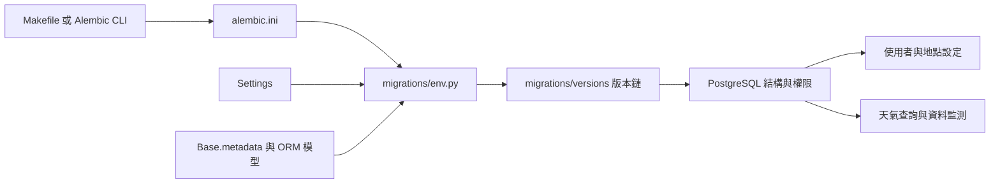
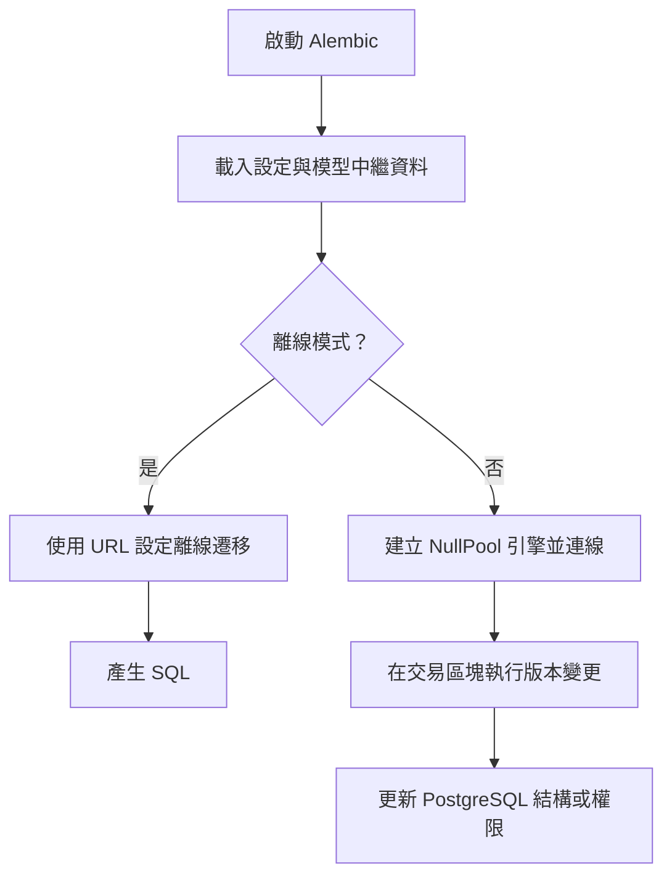
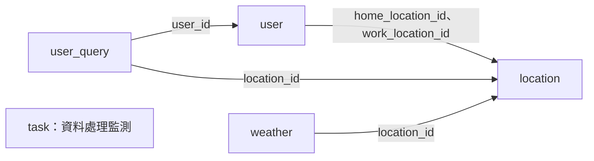

# 資料庫遷移

`database_migrations` 使用 Alembic 管理 PostgreSQL 結構及部分角色權限的版本變更。`migrations/env.py` 載入應用程式設定與 SQLAlchemy 模型，`migrations/versions/` 則以有順序的 revision 記錄升級與降版操作。這些變更為使用者、地點、天氣及資料處理監測提供資料表；模型與業務行為分別見[使用者與地點設定](users_and_location_settings.md)及[天氣查詢](weather_queries.md)。

## 架構與依賴

- `alembic.ini` 的 `script_location` 指向 `migrations`；`migrations/env.py` 以 `Base.metadata` 作為 `target_metadata`，並匯入 `User`、`UserQuery`、`Location`、`Weather`、`Task`，讓 Alembic 自動產生版本時能比較這些模型。
- `migrations/versions/` 的每個版本以 `revision`、`down_revision` 串接；`upgrade()` 套用變更，`downgrade()` 定義回退操作。
- 設定與資料庫基底見[應用程式核心](application_core.md)；容器及部署設定見[建置、部署與設定](build_deployment_and_configuration.md)。

## 執行方式與資料流

`migrations/env.py` 從 `settings.POSTGRES_USER`、`POSTGRES_PASSWORD`、`POSTGRES_HOST`、`POSTGRES_DB` 組成 `postgresql+psycopg://` URL。它沒有使用 `Settings.database_url`、`DATABASE_URL` 或 `POSTGRES_PORT`，也未在 URL 中指定連接埠；若部署使用非預設連接埠，應確認遷移實際連到預期的資料庫。`Settings` 本身還有其他必要設定，載入時也須滿足其驗證。

離線模式使用 `literal_binds=True` 和 `paramstyle=named`，在交易區塊中產生 SQL；線上模式透過 `engine_from_config` 與 `pool.NullPool` 建立連線，再於交易區塊執行遷移。離線產生的 SQL 可能包含權限版本中插入的密碼，應妥善保護輸出。

`Makefile` 提供以下入口，均在執行中的 `app` 容器內呼叫 Alembic：

| 指令 | 行為 |
| --- | --- |
| `make revision` | 以 `alembic revision --autogenerate` 比較資料庫與模型；訊息包含目前 Git 分支及時間。產生後仍須檢查遷移內容，特別是權限與資料處理。 |
| `make migrate` | 執行 `uv run alembic upgrade head`。 |
| `make rollback` | 執行 `uv run alembic downgrade -1`，回退一個版本。 |
| `make deploy` | 啟動服務並等待資料庫就緒後嘗試升級至 `head`；遷移失敗時會印出警告，之後仍印出部署完成訊息，因此須另行確認遷移結果。 |

## 版本順序與結構演進

以下依 `down_revision` 排列，從最初版本到目前程式碼中的 `head`；降版時依相反順序執行。

| 版本 | 升級內容 | 降版重點 |
| --- | --- | --- |
| `b05ddf47e04e` | 建立 `user`、`line_user_id` 唯一約束及唯一索引。 | 刪除索引與資料表。 |
| `f557a1959851` | 建立 `location`、`weather`、索引及約束；移除 `user_line_user_id_key`，保留既有唯一索引。 | 重建該唯一約束並刪除兩張表。 |
| `67c6acf6e8df` | 設定資料庫角色、表格及序列權限。 | 撤銷部分權限並刪除資料角色。 |
| `526d69e2321e` | 撤銷 `POSTGRES_USER` 對 `weather` 的寫入權限，授予 `SELECT`。 | 授予 `ALL`。 |
| `8fda37b4a59c` | 將 `weather` 的單欄 `start_time` 索引換成 `(location_id, start_time)` 與 `(location_id, fetched_at)` 索引。 | 還原單欄索引。 |
| `69db147baaec` | 授予 `WEA_DATA_USER` 對 `location` 的 `INSERT`、`UPDATE`。 | 撤銷這兩項權限。 |
| `7f11c9b6d545` | 新增 `user` 的 `home_location_id`、`work_location_id` 外鍵；將兩個 `weather` 複合索引換回單欄 `start_time` 索引。 | 還原索引並移除外鍵與欄位。 |
| `cdb5dd844b83` | 建立 `user_query`、使用者與地點外鍵，以及 `user_id`、`query_time` 索引。 | 刪除索引與資料表。 |
| `1a4a3abc97f6` | 建立記錄資料處理結果的 `task`。 | 刪除資料表。 |
| `8ef96c483fc9` | 設定 `task` 與 `task_id_seq` 權限。 | 撤銷版本中指定的權限。 |
| `d2d7367827f4` | 移除 `weather.created_at`、`weather.updated_at`。 | 重建帶有 `CURRENT_TIMESTAMP` 預設值的欄位。 |
| `bcec2f9b0ea0` | 移除 `user.display_name`。 | 重建可為空的欄位。 |

結構關係如下；`task` 不含指向其他表的外鍵。

`location.geocode` 唯一；`weather` 以 `location_id`、`start_time`、`end_time`、`fetched_at` 組合限制重複資料，並限制 `precipitation_probability` 介於 0 與 100。最新版本的 `weather` 索引是單欄 `ix_weather_start_time`，早期的複合索引已由 `7f11c9b6d545` 移除。

## 角色與權限

`67c6acf6e8df` 從環境變數讀取 `POSTGRES_USER`、`POSTGRES_DB`、`WEA_DATA_USER`、`WEA_DATA_PASSWORD`，缺少時拋出 `ValueError`。升級會給予 `POSTGRES_USER` 的 `CREATEROLE`，在角色不存在時建立 `WEA_DATA_USER`，並授予連線、`public` schema 使用、`location` 讀取、`weather` 讀寫，以及當時 `public` schema 中所有序列的 `USAGE`、`SELECT`。之後 `69db147baaec` 增加 `location` 寫入權限；`526d69e2321e` 嘗試限制 `POSTGRES_USER` 對 `weather` 的寫入。

`8ef96c483fc9` 使用固定角色名稱 `wea_data`、`wea_bot`，而非環境變數：前者取得 `task` 的 `SELECT`、`INSERT`、`UPDATE`、`DELETE` 與 `task_id_seq` 的 `USAGE`、`SELECT`；後者撤銷寫入並授予 `SELECT`。執行前須確認這些角色存在且執行者有足夠權限。表格擁有者等身分可能影響實際有效權限，應以目標資料庫的角色與權限設定為準。

## 降版與維護注意事項

- 降版會刪除資料表或欄位時連同其中資料一起移除；重新新增 `display_name` 或時間戳欄位不會還原原值。操作前應確認備份與相依服務。
- `7f11c9b6d545` 的降版對兩個外鍵呼叫 `drop_constraint(None, ...)`，未指定名稱；應先在目標 PostgreSQL 環境驗證可否執行並確認實際約束名稱。
- `67c6acf6e8df` 的降版不會撤銷先前授予的序列權限或移除 `CREATEROLE`；角色若仍有相依權限，`DROP USER` 可能失敗。`8ef96c483fc9` 的降版也只是撤銷指定權限，並不完整還原升級前狀態。
- 權限版本以字串直接組合 SQL，且部分版本透過 `os.getenv` 讀取環境變數，而非從 `Settings` 取得；執行容器的環境必須提供所需值，角色名稱與密碼也須適合這些 SQL 敘述。
- 修改 ORM 模型後，確認所有新模型均已匯入 `migrations/env.py`，檢查自動產生的升級與降版，並在適當的測試資料庫驗證。遷移記錄描述程式碼意圖；實際資料庫版本及有效權限仍須在目標環境確認。
