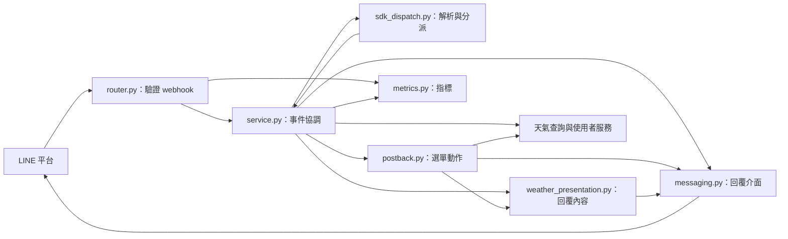
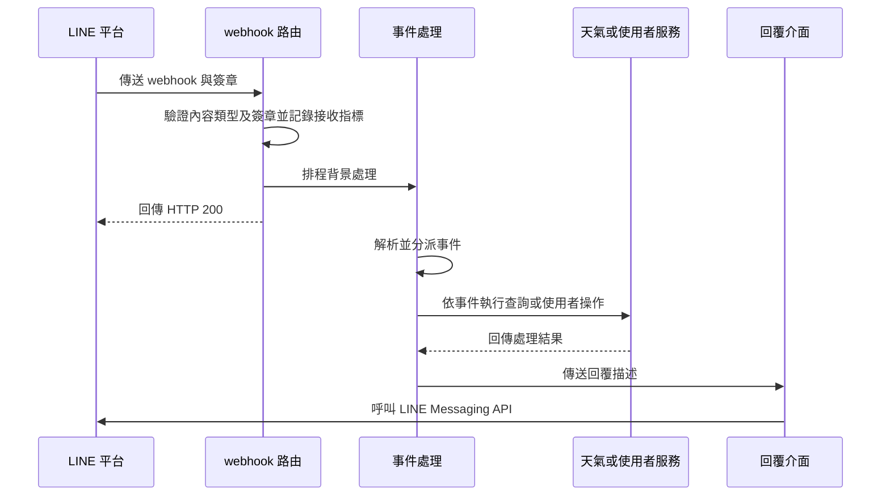

# LINE Bot 模組

`app/line/` 是 WeaMind 的 LINE Bot 介面：接收並驗證 webhook，分派事件，協調天氣查詢與使用者服務，再將結果轉成 LINE 回覆。天氣查詢及使用者資料的實作分別見[天氣查詢](weather_queries.md)與[使用者與地點設定](users_and_location_settings.md)。

## 架構概覽

## 元件與詳細文件

| 範圍 | 主要職責 | 詳細文件 |
| --- | --- | --- |
| webhook 與事件處理 | 驗證請求、排程背景工作、透過 SDK 解析和分派事件，並記錄指標 | [webhook 事件處理](line_bot/line_bot_webhook.md) |
| 回覆與天氣呈現 | 將查詢結果轉成回覆描述，透過 `ReplyMessenger` 傳送或供測試驗證 | [LINE 回覆模組](line_bot/line_bot_replies.md) |
| PostBack 動作 | 解析圖文選單資料、決定鎖定需求，並執行天氣、設定及選單動作 | [PostBack 動作處理](line_bot/line_bot_postback.md) |

## 主要資料流程

圖中為需要查詢並回覆的典型事件；其他事件可能不查詢天氣或不傳送回覆。HTTP 200 表示請求已通過入口驗證並排程，背景事件處理和訊息傳送的結果另行記錄。

## 系統關係

路由、設定與處理鎖由[應用程式核心](application_core.md)提供；天氣查詢和地點解析交由[天氣查詢](weather_queries.md)，使用者生命週期與查詢紀錄交由[使用者與地點設定](users_and_location_settings.md)。建置與部署設定見[建置、部署與設定](build_deployment_and_configuration.md)。
