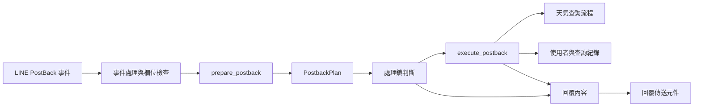
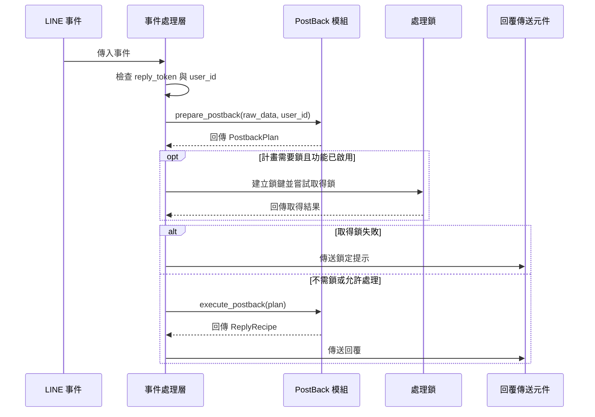
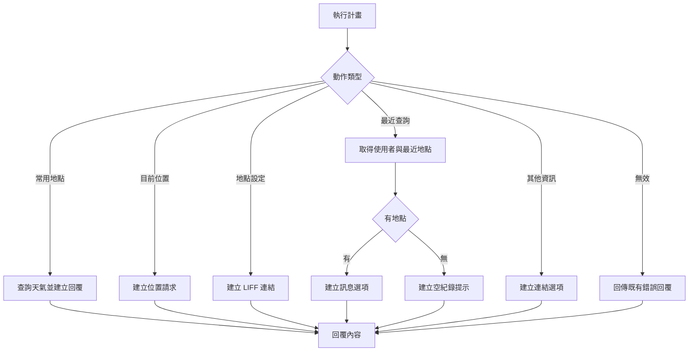

# LINE PostBack 動作處理

本模組將 LINE 圖文選單的 PostBack 資料轉為具型別的執行計畫，再產生一份回覆內容。它涵蓋常用地點天氣、目前位置、地點設定、最近查詢與其他資訊選單。程式位於 `app/line/postback.py`；`app/line/__init__.py` 標示 LINE 套件，其本身沒有處理邏輯。

## 在系統中的位置

事件接收與分派由 [Webhook 模組](line_bot_webhook.md) 負責；本模組不依賴 LINE SDK，回傳的 `ReplyRecipe` 由呼叫端交給 [回覆模組](line_bot_replies.md) 傳送。常用地點查詢依賴 [天氣查詢模組](../weather_queries.md)，歷史紀錄依賴 [使用者與地點設定模組](../users_and_location_settings.md)。處理鎖與設定屬於 [應用程式核心](../application_core.md)；LINE 整體架構見 [LINE Bot](../line_bot.md)。

## 計畫與動作

`prepare_postback(raw_data, user_id)` 解析資料並回傳不可變的 `PostbackPlan`，其中包含 `action`、`requires_lock` 和取得鎖失敗時的 `lock_denied_recipe`。各動作也都是不可變的資料類別；`PostbackAction` 列舉所有支援的動作類型。

| 輸入資料 | 動作及攜帶資料 | 需要鎖 | 執行結果 |
| --- | --- | --- | --- |
| `action=weather&type=home` 或 `type=office` | `PresetWeatherAction(user_id, location_type)` | 是 | 查詢住家或公司天氣，轉成天氣回覆 |
| `action=weather&type=current` | `CurrentWeatherAction` | 否 | 要求使用者開啟地圖並分享位置 |
| `action=settings&type=location` | `LocationSettingsAction` | 否 | 回傳地點設定頁面的連結 |
| `action=recent_queries` | `RecentQueriesAction(user_id)` | 是 | 回傳最近查詢地點的選項或空紀錄提示 |
| `action=other&type=menu` | `OtherMenuAction` | 否 | 回傳更新、使用說明與專案介紹連結 |
| 未知或不完整的動作 | `InvalidAction(recipe)` | 否 | 回傳對應的錯誤文字 |

解析使用 `parse_qs(raw_data, keep_blank_values=False)`：空值會被忽略，同名參數只取第一個保留的值。空字串或解析例外會視為空資料；未知的 `weather` 類型回覆「未知的地點類型」，未知的 `settings` 類型回覆「未知的設定類型」，其他未知動作或 `other` 類型回覆「未知的操作」。未知設定、其他選單類型與動作會記錄警告，解析例外會記錄例外。

## 事件處理與鎖定

`handle_postback_event` 缺少 `reply_token` 或來源的 `user_id` 時會記錄警告並結束，不建立計畫。需要鎖且 `PROCESSING_LOCK_ENABLED` 為真時，處理層以事件來源建立使用者鎖鍵；若有鎖鍵且取得失敗，傳送「操作太過頻繁，請放慢腳步 ☕️」，不執行動作。無法建立鎖鍵時則繼續執行。

鎖使用 Redis 的原子 `SET`、`NX` 和過期時間，靠 TTL 自動到期；Redis 無法使用或發生連線錯誤時採取允許處理的策略。鎖的決策與取得均在事件處理層；直接呼叫 `execute_postback` 不會自動取得鎖。

## 動作執行

`execute_postback(plan)` 依動作類型回傳一個 `ReplyRecipe`：

- **常用地點天氣**：呼叫 `query_preset(user_id, location_type)`，依 `home` 或 `office` 選擇 `QueryKind.PRESET_HOME` 或 `QueryKind.PRESET_OFFICE`，再由 `build_weather_reply` 產生回覆。使用者或對應地點不存在時，查詢流程回傳 `QueryOutcome.PRESET_NOT_SET`，交由呈現層處理。
- **目前位置**：回傳 `LocationRequestRecipe`，請使用者在地圖選擇位置。後續位置訊息的處理屬於 Webhook 流程。
- **地點設定**：以 `settings.BASE_URL` 加上 `/static/liff/location/index.html` 組成 LIFF 連結，放入 `TextRecipe`。
- **最近查詢**：開啟資料庫工作階段，依 LINE 使用者 ID 查找使用者；若不存在則建立，再以 `get_recent_queries(..., limit=5)` 取得地點。該服務排除已設定的住家與公司地點，按時間由近到遠去重，最多檢查最近 100 筆紀錄。地點名稱在關閉工作階段前轉成 tuple；有結果時以名稱作為 `MessageChoice` 的標籤和訊息文字，無結果時回傳提示文字。
- **其他資訊**：以 `UriChoicesRecipe` 依序提供 `CHANGELOG.md`、`README.md` 與專案介紹頁面的連結。
- **無效動作**：直接回傳 `InvalidAction.recipe`。

## 例外與維護

`execute_postback` 記錄未預期的執行例外，常用地點天氣動作回傳「查詢時發生錯誤，請稍後再試。」；其他動作回傳「系統暫時有點忙，請稍後再試一次。」。事件處理層也有外層例外處理：記錄例外後，若有 `reply_token`，會嘗試傳送後者作為備援回覆。回覆內容的產生與實際傳送是不同步驟。

`tests/line/test_postback.py` 涵蓋動作與鎖定策略、無效輸入、不可變計畫、各種回覆、資料庫工作階段關閉、例外回覆與事件處理層的鎖定行為。新增動作時，應同步考量輸入映射、動作資料、鎖定需求、執行結果及失敗處理。
