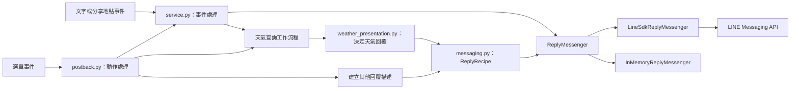
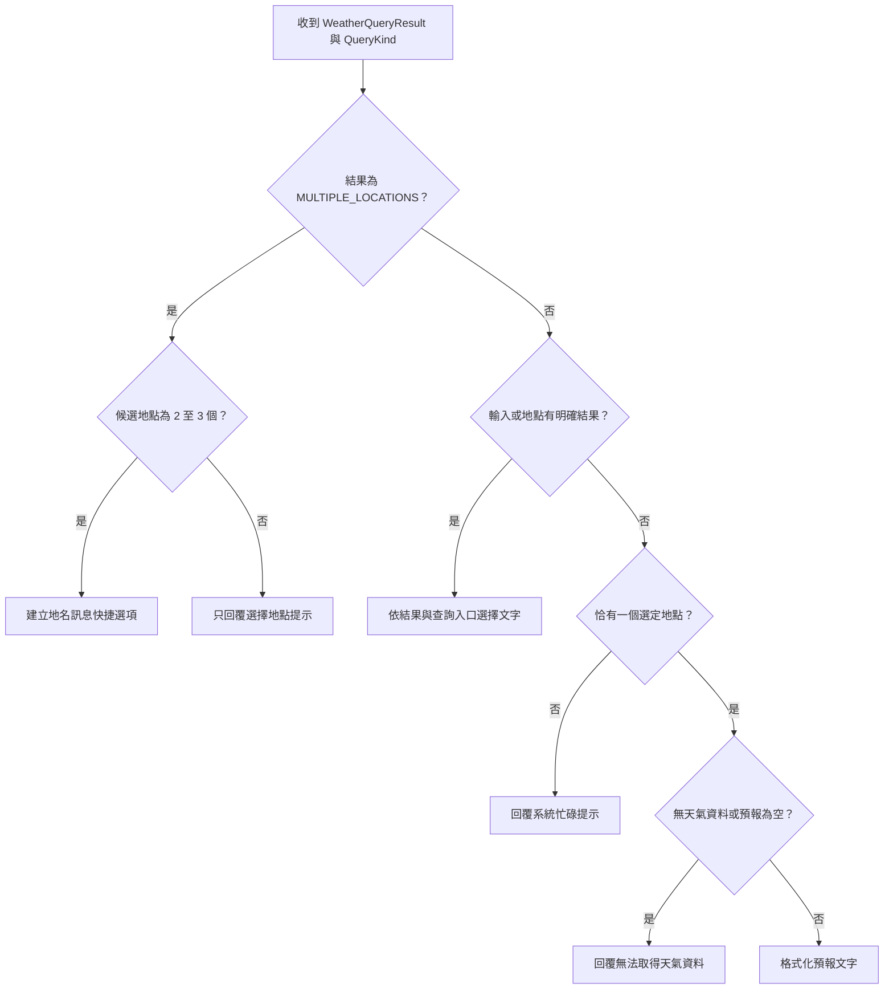
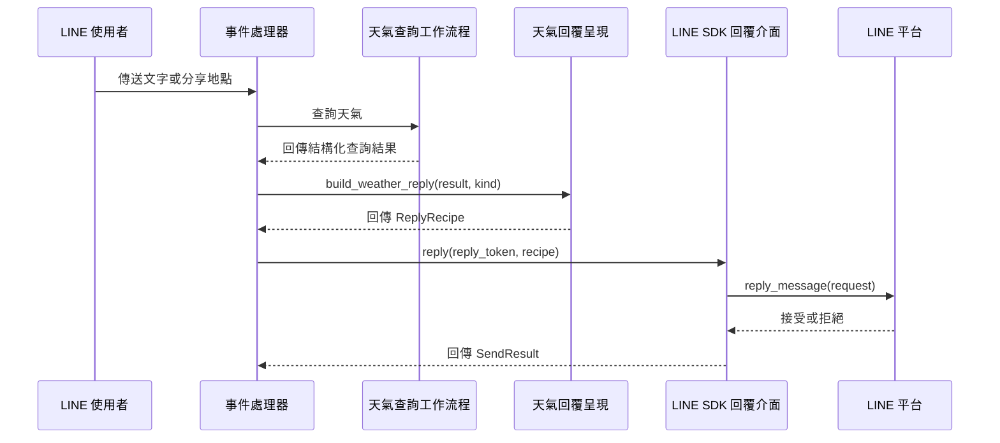

# LINE 回覆模組

`line_bot_replies` 將天氣查詢結果轉為使用者可讀的回覆，並透過一致介面傳送 LINE 訊息。不可變的回覆描述（recipe）隔開應用程式邏輯與 LINE SDK，記憶體 adapter 則供測試使用。事件接收見 [LINE webhook](line_bot_webhook.md)，選單動作見 [LINE Postback](line_bot_postback.md)，整體關係見 [LINE Bot](../line_bot.md)。

## 架構與責任

- `app/line/weather_presentation.py` 接收與 ORM 無關的 `WeatherQueryResult` 和查詢入口 `QueryKind`，決定一個回覆描述。
- `app/line/messaging.py` 定義回覆描述、傳送結果及 `ReplyMessenger` protocol；正式 adapter 轉換 LINE SDK 模型，測試 adapter 記錄描述。
- `app/line/service.py` 協調事件與回覆；`app/line/postback.py` 除了呼叫天氣呈現層，也直接建立地圖、近期查詢與網址等回覆描述。天氣查詢與資料結構見[天氣查詢](../weather_queries.md)。

## 回覆描述與驗證

`ReplyRecipe` 是四種不可變、使用 `slots` 的資料類別聯集。建立物件時即驗證必要字串，空字串或只有空白會引發 `ValueError`；驗證不會修改原始字串。

| 類型 | 欄位 | 用途 |
| --- | --- | --- |
| `TextRecipe` | `text` | 純文字回覆 |
| `MessageChoicesRecipe` | `text`、`choices: tuple[MessageChoice, ...]` | 文字與訊息快捷選項；每個選項有 `label` 和傳送用的 `text` |
| `LocationRequestRecipe` | `text`、`label` | 文字與分享位置快捷動作 |
| `UriChoicesRecipe` | `text`、`choices: tuple[UriChoice, ...]` | 文字與網址快捷選項；每個選項有 `label` 和 `uri` |

選項集合必須有 1 到 13 個項目，選項的必要欄位也不得為空。`UriChoice.uri` 必須是含有網域的絕對 `http` 或 `https` URL。這些檢查發生在建立描述時，呼叫端應先準備有效資料。

## 天氣回覆決策

`build_weather_reply(result, kind)` 針對正常查詢結果回傳一個 `ReplyRecipe`。`QueryKind` 的值為 `TEXT`、`SHARED_LOCATION`、`PRESET_HOME` 和 `PRESET_OFFICE`；目前它用於未設定預設地點時區分住家、公司與一般提示。

| `QueryOutcome` 或資料狀態 | 回覆方式 |
| --- | --- |
| `MULTIPLE_LOCATIONS` | 2 至 3 個候選地點提供 `MessageChoicesRecipe`，標籤與訊息均為 `full_name`；其他數量只顯示提示文字 |
| `INVALID_INPUT` | 依 `EMPTY`、`INVALID_LENGTH` 或 `NON_CHINESE` 顯示提示；缺少原因時使用一般格式錯誤提示 |
| `TOO_MANY_LOCATIONS` | 請使用者輸入更具體的地名 |
| `LOCATION_NOT_FOUND` | 顯示查詢地名與二級行政區範例；缺少查詢文字時使用通用稱呼 |
| `OUTSIDE_TAIWAN` | 說明目前僅支援台灣地區 |
| `PRESET_NOT_SET` | 依 `QueryKind` 提示設定住家或公司；其他入口使用一般未設定提示 |
| 缺少唯一選定地點 | 顯示系統忙碌提示 |
| `NO_WEATHER` 或預報為空 | 顯示該地點暫時無法取得天氣資料 |
| 其他具有地點及非空預報的結果 | 格式化預報文字 |

預報最多顯示前 8 筆，第 4 筆後若還有資料則插入空行。每筆顯示天氣圖示、起訖小時、最高溫與降雨機率；缺少圖示時使用 `⛅`，降雨機率為空或零時顯示 `0%`。更新時間取第一筆的 `fetched_at`。程式將時間欄位視為 UTC，再轉換為 UTC+8 顯示；資料的產生與查詢規則見[天氣查詢](../weather_queries.md)。

## 傳送與元件互動

`ReplyMessenger.reply(reply_token, recipe)` 接受可為 `None` 的 token，並回傳 `SendResult`。正式服務以 `settings.LINE_CHANNEL_ACCESS_TOKEN` 建立 `LineSdkReplyMessenger`，SDK callback 將它注入事件處理器。文字與分享地點處理器在查詢或呈現時發生例外，會改用系統忙碌文字；Postback 的動作與錯誤處理見 [LINE Postback](line_bot_postback.md)。

`LineSdkReplyMessenger` 先檢查 token，再將描述轉為一個 `ReplyMessageRequest`，其中包含一則 `TextMessage`，`notificationDisabled=False`。純文字不附 `QuickReply`；訊息、位置和網址選項分別轉成 `MessageAction`、`LocationAction` 和 `URIAction`。每次回覆使用新的 `ApiClient` 並在結束時關閉；由於 reply token 為單次使用，adapter 不會重試。

### 傳送結果與錯誤

`SendResult.sent()` 表示 `success=True` 且沒有錯誤類別；`SendResult.failed(category)` 表示 `success=False` 且有錯誤類別。不一致的組合會引發 `ValueError`。正式 adapter 將 SDK 與傳輸例外收斂成以下類別，不讓例外直接穿透回覆介面：

| `SendErrorCategory` | 條件 |
| --- | --- |
| `INVALID_REQUEST` | token 缺失或為空，或 LINE API 回傳 HTTP 400 |
| `AUTHENTICATION` | LINE API 回傳 HTTP 401 或 403 |
| `RATE_LIMITED` | LINE API 回傳 HTTP 429 |
| `LINE_API` | 其他 `ApiException` 狀態 |
| `TRANSPORT` | `HTTPError` 或 `OSError` |
| `INTERNAL` | 建立請求或傳送過程中的其他例外 |

API 拒絕會記錄類別與狀態碼；傳輸及非預期錯誤會記錄例外。成功結果表示 SDK 的傳送呼叫未拋出例外。現有事件處理器呼叫 `reply` 後不依 `SendResult` 重試。

## 測試介面

`InMemoryReplyMessenger` 實作相同的 `reply` 介面，不建立 SDK 模型或連線。有效 token 且未設定失敗時，它將 `SentReply(reply_token, recipe)` 加入 `sent_replies` 並回傳成功；可用 `failure_category` 模擬失敗，失敗時不記錄回覆。空 token 優先回傳 `INVALID_REQUEST`。測試因此可直接斷言回覆內容與選項，而不必依賴 LINE 服務。

`tests/line/test_messaging.py` 涵蓋描述驗證、SDK 轉換、傳送結果與錯誤分類；`tests/line/test_weather_presentation.py` 涵蓋天氣結果與格式；`tests/line/test_service_basic.py` 和 `tests/line/test_postback.py` 驗證整合呼叫。
