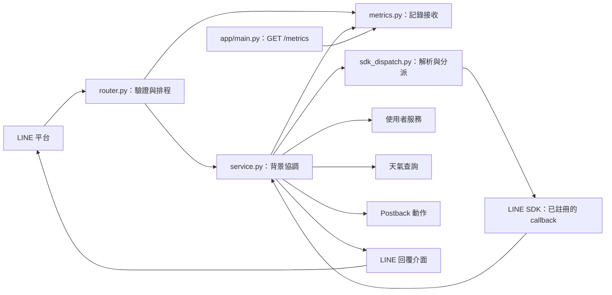
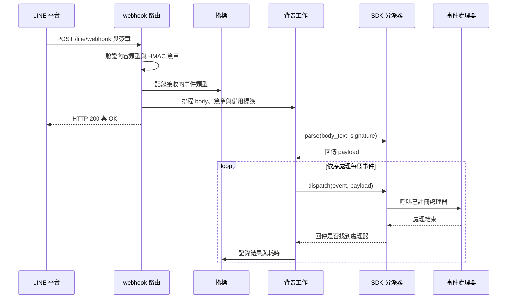
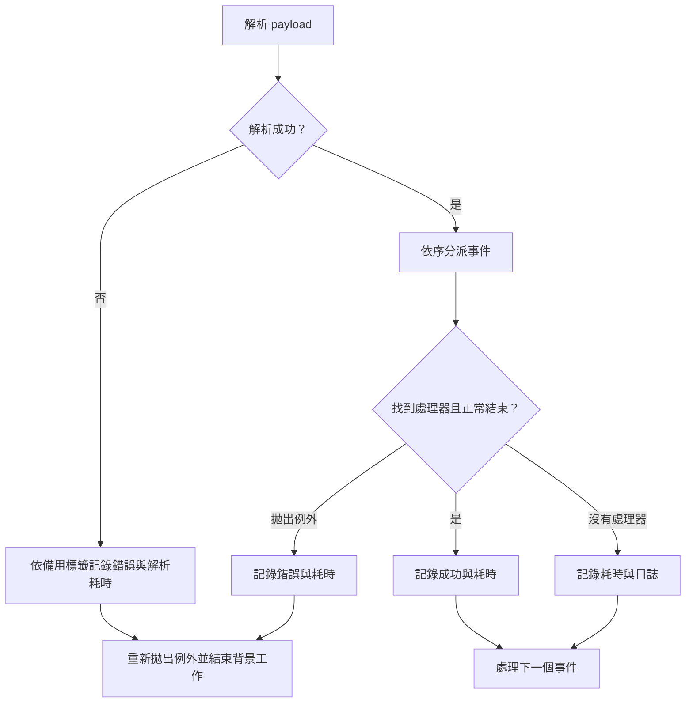

# LINE webhook 事件處理

`line_bot_webhook` 是 WeaMind 接收 LINE webhook 的入口：先驗證 HTTP 請求與簽章，再交由背景工作解析及逐一分派事件，並記錄接收、處理結果和耗時。事件處理器協調天氣查詢、使用者生命週期、Postback 與 LINE 回覆；整體位置見 [LINE Bot 模組](../line_bot.md)。

## 架構與職責

| 元件 | 職責 |
| --- | --- |
| `app/line/router.py` | 提供 `POST /line/webhook`，同步檢查請求、記錄接收指標並排程背景工作 |
| `app/line/sdk_dispatch.py` | 封裝 LINE SDK 的 payload 解析、處理器查找與呼叫 |
| `app/line/service.py` | 逐事件分派、計量處理結果，並實作事件處理及 SDK callback |
| `app/line/metrics.py` | 正規化事件類型，維護 Prometheus 指標與輸出格式 |
| `app/main.py` | 掛載 LINE router，並以 `GET /metrics` 暴露指標 |

## 請求驗證與快速回應

`line_webhook` 要求 `X-Line-Signature` 標頭，並依序執行：

1. 檢查 `Content-Type` 是否以 `application/json` 開頭；不符合時回傳 HTTP 400，內容為 `Invalid content type`。
2. 讀取一次原始 body，以 `settings.LINE_CHANNEL_SECRET` 計算 HMAC-SHA256，再將摘要編碼為 Base64，使用 `hmac.compare_digest` 與標頭比較。計算失敗或簽章不符分別回傳 HTTP 400，內容為 `Signature verification error` 或 `Invalid signature`。
3. 將 body 解碼為 UTF-8，以原始 JSON 分類事件並記錄接收指標。日誌記錄長度，不記錄完整 body。
4. 將 body、簽章及分類結果交給 FastAPI `BackgroundTasks`，回傳 HTTP 200 與 `{"message": "OK"}`。背景工作在回應送出後執行，捕捉並記錄例外。

缺少必填標頭由 FastAPI 的請求驗證處理。UTF-8 解碼及事件分類不在路由的例外處理範圍內；例如合法 JSON 若頂層不是物件，`extract_event_types_from_body` 的 `payload.get` 會失敗，無法到達排程與 ACK。HTTP 200 表示請求已通過入口步驟並排定工作，不表示所有事件或回覆已完成；背景工作依賴應用程式行程，程式碼未提供持久化佇列或重試。

## 解析與事件分派

`process_webhook_events` 透過 `LineSdkWebhookDispatcher.parse` 呼叫 SDK parser，以 `as_payload=True` 再次驗證並解析簽章及 body。回傳值符合 `ParsedWebhookPayload` protocol，提供 `events: list[object]` 與可為 `None` 的 `destination`；原始 payload 也傳給 SDK 處理器。

分派器對 `MessageEvent` 先查事件類別與訊息類別的組合，再查事件類別，最後使用 SDK 的預設處理器。找到處理器時呼叫並回傳 `True`，否則回傳 `False`。實作使用 SDK 的私有處理器表、鍵值產生與呼叫方法；升級 `line-bot-sdk` 時應檢查相容性。依賴宣告見 `pyproject.toml`。

| 事件 | 註冊處理器與後續工作 |
| --- | --- |
| 文字訊息 | `_handle_message_event_callback` 注入正式 messenger；`handle_message_event` 呼叫 `query_text`，建立並傳送天氣回覆 |
| 分享地點 | `_handle_location_message_event_callback` 呼叫 `handle_location_message_event`，以座標、地址與使用者 ID 呼叫 `query_shared_location` |
| `FollowEvent` | `_handle_follow_event_callback` 注入正式 messenger，交由 `handle_follow_event` 建立或重新啟用使用者 |
| `UnfollowEvent` | `handle_unfollow_event` 將已知使用者停用 |
| `PostbackEvent` | `_handle_postback_event_callback` 呼叫 `handle_postback_event`，準備並執行選單動作 |
| 其他事件 | `handle_default_event` 記錄未處理事件類型 |

文字與地點訊息缺少 `reply_token` 或訊息類型不符時直接結束；查詢或產生回覆發生例外時，改用系統忙碌文字。Postback 在有使用者 ID 和回覆 token 時準備動作，必要且啟用時先取得處理鎖；鎖被拒絕則回覆該動作的拒絕訊息。天氣查詢、選單動作及回覆格式分別見[天氣查詢](../weather_queries.md)、[LINE Postback](line_bot_postback.md)及 [LINE 回覆](line_bot_replies.md)。

### 加入與封鎖好友

`handle_follow_event` 先從 `event.source` 取得 `user_id`；缺少時記錄警告並結束。接著在 `SessionLocal` 的 session 中呼叫 `create_user_if_not_exists`，建立新使用者或重新啟用既有帳號。離開 session 後，若有 `reply_token`，才傳送歡迎訊息，避免等待 LINE API 時占用資料庫連線。例外由處理器記錄並攔截。`handle_unfollow_event` 同樣要求 `user_id`，呼叫 `deactivate_user`；查無使用者時記錄警告。使用者資料規則見[使用者與地點設定](../users_and_location_settings.md)。

## 指標與錯誤邊界

`GET /metrics` 透過 `metrics_response` 輸出 Prometheus 文字格式。指標使用行程內的預設 registry；目前沒有跨 worker 聚合。

| 指標 | 標籤 | 記錄時機 |
| --- | --- | --- |
| `line_webhook_events_total` | `event_type` | 路由完成簽章驗證及分類後，依分類結果逐項遞增 |
| `line_webhook_events_success_total` | `event_type` | 事件找到處理器且呼叫正常結束 |
| `line_webhook_events_error_total` | `event_type`、`error_type` | 解析或處理器呼叫拋出例外 |
| `line_webhook_event_duration_seconds` | `event_type` | 每個已開始分派事件的耗時；解析失敗時記錄解析耗時 |

事件類型包括 `message_text`、`message_location`、`follow`、`unfollow`、`postback`、`default` 與 `unknown`。原始 body 分類時，無法解析的 JSON、缺少或空的 `events` 清單，以及沒有任何物件事件的清單，會得到一個 `unknown`；混合清單中的非物件項目會被略過。SDK 解析後則根據事件物件屬性分類。

解析失敗時使用路由提供的分類作為備用標籤，未提供或為空時使用 `unknown`。SDK 的 `InvalidSignatureError` 記為 `signature_error`，其他例外記為 `handler_error`；例外會向外傳播至背景工作邊界。逐事件處理時，任何未攔截的例外都會終止同一 payload 中後續事件的處理。未找到處理器時只記錄耗時；預設處理器若存在並正常結束，也算分派成功。

成功指標衡量的是處理器呼叫正常結束：處理器可能因缺少資料而提早結束，或自行捕捉例外；回覆介面也可能以 `SendResult` 表示傳送失敗而不拋出例外。因此它不等同於業務操作或訊息送達成功。入口驗證失敗則發生在接收計數之前，不計入這些背景錯誤指標。

## 設定與維護

`LINE_CHANNEL_SECRET` 用於路由及 SDK 的簽章驗證；`LINE_CHANNEL_ACCESS_TOKEN` 用於建立正式回覆介面。Postback 的處理鎖受 `PROCESSING_LOCK_ENABLED`、`PROCESSING_LOCK_TTL_SECONDS` 與 `REDIS_URL` 控制；Redis 無法使用時採允許處理的策略。設定來源與其他系統元件見[應用程式核心](../application_core.md)。

維護時可參考 `tests/line/test_webhook.py`、`tests/line/test_metrics.py`、`tests/line/test_sdk_dispatch.py` 與 `tests/line/test_service_basic.py`，分別檢查入口、指標、SDK 分派與事件處理。執行相關測試使用 `uv run pytest tests/line/test_webhook.py tests/line/test_metrics.py tests/line/test_sdk_dispatch.py tests/line/test_service_basic.py`。
