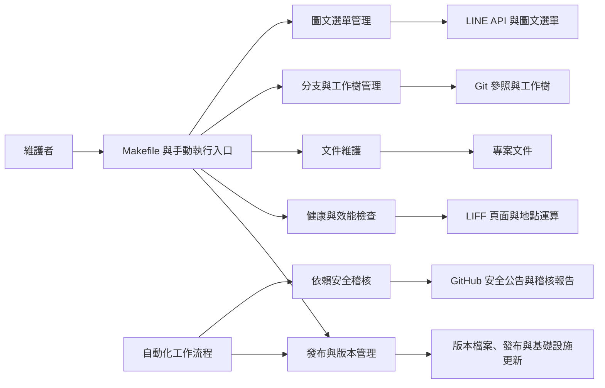

# 維運與開發腳本

`scripts` 目錄提供 WeaMind 的維運與開發工具，涵蓋版本發布、健康與效能檢查、依賴安全稽核、文件維護、Git 分支與工作樹管理，以及 LINE 圖文選單管理。這些腳本分別由維護者手動執行或由工作流程觸發，服務於不同的維護需求。

## 架構

各類工具依用途獨立運作；例如健康檢查與效能測試互不呼叫，文件工具和 Git 管理腳本也各自執行。部分操作會修改檔案、Git 參照或外部服務，執行方式與影響範圍請參考各元件文件。

## 核心元件

- [發布與版本管理](operational_and_development_scripts/release_and_version_management.md)：維護 CHANGELOG 和應用程式版本、提出基礎設施映像更新，以及更新前端資源版本標記。
- [健康與效能檢查](operational_and_development_scripts/health_and_performance_checks.md)：檢查 LIFF 頁面與 SDK 的可存取性，並量測地點距離計算及座標範圍判斷。
- [依賴安全稽核](operational_and_development_scripts/dependency_security_audit.md)：查詢被 `pip-audit` 忽略的 GitHub 安全公告，提示需要重新評估的項目。
- [文件維護工具](operational_and_development_scripts/documentation_utilities.md)：產生專案目錄樹、匯出分支文件，以及清理 `docs` 最上層檔案。
- [Git 分支與工作樹管理](operational_and_development_scripts/git_branch_and_worktree_management.md)：預覽或清理本地分支，並建立、列出、移除及清理 Git worktree。
- [LINE 圖文選單管理](operational_and_development_scripts/line_rich_menu_management.md)：透過 LINE API 建立、列出、刪除圖文選單，並上傳圖片或設定預設選單。
