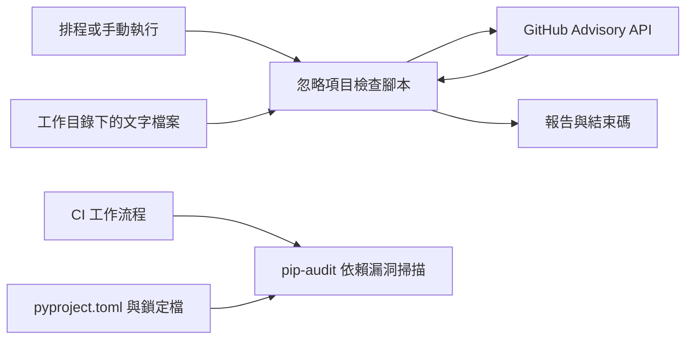
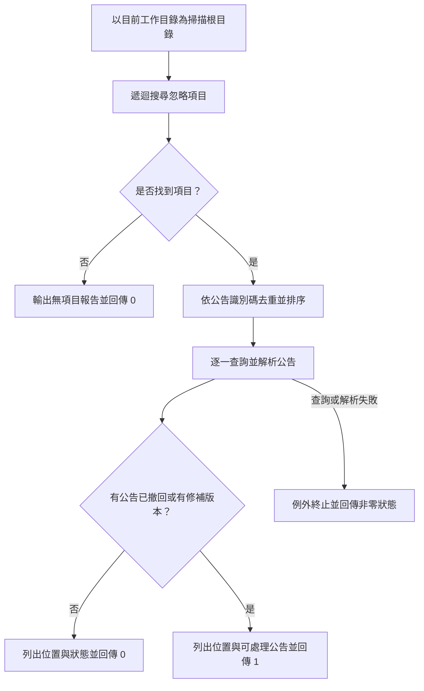

# 依賴安全稽核

`dependency_security_audit` 透過 `scripts/check_pip_audit_ignores.py` 找出儲存庫中被 `pip-audit` 忽略的 GitHub Security Advisory（GHSA），再查詢公告是否已撤回或出現修補版本，提醒維護者重新評估忽略設定。它不會安裝、升級套件或修改檔案，也不會取代實際的依賴漏洞掃描。

## 系統位置與依賴

此腳本是維運工具，使用 Python 標準函式庫讀取本機檔案與呼叫 GitHub Advisory API，並輸出文字報告及程序結束碼。排程由 `.github/workflows/check-pip-audit-ignores.yml` 執行；獨立的 CI 則執行 `pip-audit`。工作流程的其他設定見[建置與部署自動化](../build_deployment_and_configuration/build_deployment_and_configuration_automation.md)，工具與依賴設定見[品質與依賴設定](../build_deployment_and_configuration/build_deployment_and_configuration_quality.md)，其他維運腳本見[維運與開發腳本](../operational_and_development_scripts.md)。



## 資料結構與元件

| 元件 | 職責 |
| --- | --- |
| `IgnoreHit` | 不可變資料類別，記錄公告的 `advisory_id`、相對於掃描根目錄的 `path` 與從 1 開始的 `line_number`。同一行的多個符合項目各自產生紀錄。 |
| `AdvisoryStatus` | 不可變資料類別，保存 `advisory_id`、`html_url`、`summary`、`withdrawn_at` 與去重排序後的 `patched_versions`。 |
| `AdvisoryStatus.is_actionable` | 當 `withdrawn_at` 不是 `None`，或 `patched_versions` 非空時為真，表示值得重新評估。 |
| `find_ignore_hits` / `should_skip` | 遞迴讀取文字檔案，排除指定路徑，擷取符合格式的忽略項目。 |
| `fetch_advisory` / `parse_advisory` | 查詢 GitHub 公告，並將回應轉為檢查所需的狀態。 |
| `print_report` / `main` | 彙整位置與公告狀態，輸出報告並決定結束碼。 |

## 處理流程



1. `main` 使用 `Path.cwd()` 作為根目錄；應從儲存庫根目錄執行，才能涵蓋預期範圍。
2. `find_ignore_hits` 以 `rglob("*")` 掃描檔案，略過路徑中含 `.git`、`.mypy_cache`、`.pytest_cache`、`.ruff_cache`、`.venv`、`__pycache__`、`htmlcov` 或 `security-reports` 的項目。無法以 UTF-8 解碼的檔案會略過。
3. `IGNORE_PATTERN` 搜尋 `--ignore-vuln=` 後緊接 `GHSA-` 與三段小寫英數識別碼的字面文字；不解析設定檔語法，也不辨識其他忽略格式或其他公告識別碼。同一公告的所有位置都會保留，但查詢前會依識別碼去重。
4. `fetch_advisory` 對每個識別碼依序呼叫 `https://api.github.com/advisories/{advisory_id}`，設定 GitHub JSON 接受格式、API 版本 `2022-11-28` 與 30 秒逾時。若環境變數 `GITHUB_TOKEN` 有值，會以 Bearer token 隨請求送出。
5. `parse_advisory` 從每個 `vulnerabilities` 項目收集非空的 `first_patched_version`，轉成字串、去重並排序；同時讀取摘要、公告網址與撤回時間。
6. `print_report` 先列出所有命中位置，再依公告狀態輸出結果。查詢或解析例外未在 `main` 中捕捉，程序會失敗，而非產生完整狀態報告。

## 執行與結果

在儲存庫根目錄執行：

```sh
uv run python scripts/check_pip_audit_ignores.py
```

腳本本身只需 Python 標準函式庫；存在命中項目時需要連線至 GitHub Advisory API。`GITHUB_TOKEN` 為選用設定。`.github/workflows/check-pip-audit-ignores.yml` 在每週一 03:00 UTC 排程執行，也支援 `workflow_dispatch`；該工作在 `ubuntu-latest` 簽出程式碼，將 `github.token` 傳為 `GITHUB_TOKEN`，並以 `python3 scripts/check_pip_audit_ignores.py` 執行。工作流程的權限為 `contents: read`。

| 結果 | 意義 |
| --- | --- |
| `0` | 沒有符合格式的忽略項目，或所有已查詢公告都沒有撤回時間及修補版本。 |
| `1` | 至少一則公告符合 `is_actionable`；報告列出其摘要、可用的撤回時間、修補版本與公告網址。 |
| 非零且因例外終止 | 查詢、讀取或解析發生錯誤，應檢查錯誤訊息與執行環境；這不是已完成的安全判定。HTTP 與 URL 錯誤會附上公告識別碼及錯誤資訊。 |

可處理狀態只是人工追蹤訊號：腳本不會核對修補版本是否適用於目前安裝的套件，也不會確認升級後的相容性。維護者應查看公告與受影響依賴，評估升級或移除忽略設定，再重新執行 `pip-audit` 和適當測試。CI 中的實際掃描命令是 `uv run pip-audit --progress-spinner=off`，其開發依賴宣告於 `pyproject.toml`，工作步驟定義於 `.github/workflows/ci.yml`。

## 維護注意事項

- 掃描以文字為準，註解、文件或測試資料中的符合字串也可能成為命中項目；它不會確認該選項是否真的由 `pip-audit` 使用。
- 腳本不會限制公告中的修補版本對應特定套件，也不會檢查目前依賴版本；多個受影響項目的修補版本會合併呈現。
- API 呼叫逐一進行，沒有重試或快取；網路、授權、速率限制或服務錯誤可能使整次檢查失敗。其他檔案讀取錯誤也可能中止執行。
- 報告反映執行當下的工作目錄與 GitHub API 回應；沒有符合項目不代表依賴沒有漏洞。
