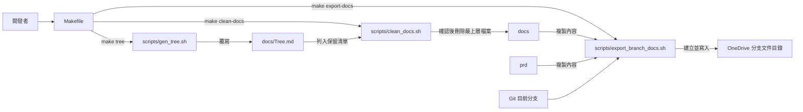
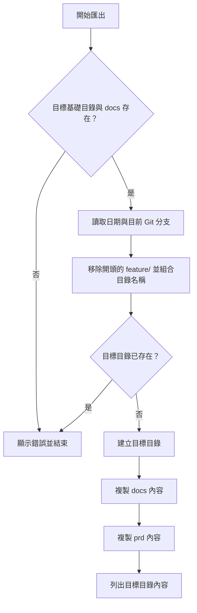

# 文件維護工具

本模組由三支獨立的 zsh 腳本組成，協助維護 WeaMind 的專案文件：產生目錄樹、匯出目前分支的文件，以及清理 `docs` 最上層的檔案。它們是開發環境中的手動工具，不參與 LINE Bot 的執行期請求處理。其他維運腳本的範圍見[維運與開發腳本](../operational_and_development_scripts.md)。

## 架構與入口

`Makefile` 為每支腳本提供一個目標；三支腳本彼此不呼叫，透過檔案系統上的 `docs` 產生關聯。以下路徑及命令皆以儲存庫根目錄為工作目錄。



| 入口 | 實際命令 | 主要效果 |
| --- | --- | --- |
| `make tree` | `zsh scripts/gen_tree.sh` | 覆寫 `docs/Tree.md` |
| `make export-docs` | `zsh scripts/export_branch_docs.sh` | 複製 `docs` 與 `prd` 內容至分支目錄 |
| `make clean-docs` | `zsh scripts/clean_docs.sh` | 經互動確認後刪除指定範圍的檔案 |

入口定義見 `Makefile`；其餘建置與部署目標見[建置、部署與設定](../build_deployment_and_configuration.md)。

## 產生專案目錄樹

`scripts/gen_tree.sh` 先以標題和空行覆寫 `docs/Tree.md`，再將以下命令的輸出附加到檔案：

```bash
tree -L 3 -a -I '.*|__pycache__|coverage_html_report'
```

`-L 3` 限制顯示深度，`-a` 要求包含隱藏項目，但 `-I` 的 `.*` 模式會排除名稱以點開頭的項目；另排除 `__pycache__` 和 `coverage_html_report`。需要已安裝的 `tree` 命令，以及可寫入的 `docs` 目錄。腳本沒有先檢查依賴，也沒有設定 `set -e`；若 `tree` 失敗，原有 `docs/Tree.md` 仍可能已被覆寫成只有標題的檔案，應檢查命令結果與檔案內容。

## 匯出分支文件

`scripts/export_branch_docs.sh` 將目前工作目錄中的 `docs/*` 和 `prd/*` 依序複製到同一個新目錄，省略各自的父目錄名稱，保留其下子目錄結構。它複製的是工作目錄中的內容，包括尚未提交的變更，不會從 Git 提取特定 commit。



- 基礎路徑固定為 `/Users/kyo/Library/CloudStorage/OneDrive-個人/WeaMind/branch-docs`，必須事先存在；移至其他環境時需調整腳本。
- 子目錄名稱為 `YYYY-MM-DD-<分支名稱>`；只移除分支名稱開頭的 `feature/`。例如 `feature/location-settings` 會成為 `YYYY-MM-DD-location-settings`。其他斜線仍會作為路徑分隔符號。
- 同名目標目錄已存在時，腳本拒絕繼續。它只預先檢查基礎目錄與 `docs`，未預先檢查 `prd` 或兩個來源的名稱衝突。
- `*` 不包含點開頭的頂層項目；來源缺少可匹配項目、`prd` 不存在或複製失敗時，zsh 的展開或命令可能使腳本中止。同名項目合併到同一目標，可能覆寫或發生複製衝突，應先檢查來源。
- 腳本使用 `set -e`，失敗時不會回滾已建立的目錄或已複製的檔案；重試前應檢查並處理留下的目標目錄。

## 清理文件

`scripts/clean_docs.sh` 先確認 `docs` 存在，再列出最上層非隱藏項目；目錄會被跳過，以下四個檔案名稱會保留：

- `Architecture.md`
- `Example.md`
- `Todo.md`
- `Tree.md`

其餘候選項目先列印供使用者確認，腳本接著以 `read -q` 讀取單一按鍵；同意後才對候選中符合 `-f` 的項目執行 `rm`。因此清理不遞迴進入子目錄，隱藏項目也不在 `*` 展開範圍內；候選清單中的特殊檔案不一定會被刪除。取消或讀取失敗會以非零狀態結束。腳本設定了 `set -e`，因此拒絕回覆時 `read -q` 本身可能先觸發退出，而不會顯示後續的取消訊息。

腳本含有空目錄的處理分支，但在預設 zsh 設定下，沒有符合 `*` 的項目時，展開可能先報錯；不要依賴該分支保證成功退出。執行前應仔細檢查清單，刪除後不會自動還原。

## 使用與維護注意事項

1. 在儲存庫根目錄執行上述 `make` 目標；腳本使用相對路徑，並依賴 `zsh` 及各自使用的系統命令。
2. 若需要保存目前文件，可先執行 `make export-docs` 並檢查輸出，再視需要執行 `make clean-docs`。這是操作順序建議，腳本本身沒有建立依賴或自動備份。
3. 執行 `make tree` 後檢查 `docs/Tree.md` 的差異；執行清理前確認候選清單，匯出失敗則檢查是否留下部分內容。
4. 保留清單、匯出路徑與排除模式都寫在各自腳本內，調整行為時應直接檢查對應的 `scripts/clean_docs.sh`、`scripts/export_branch_docs.sh` 或 `scripts/gen_tree.sh`。
