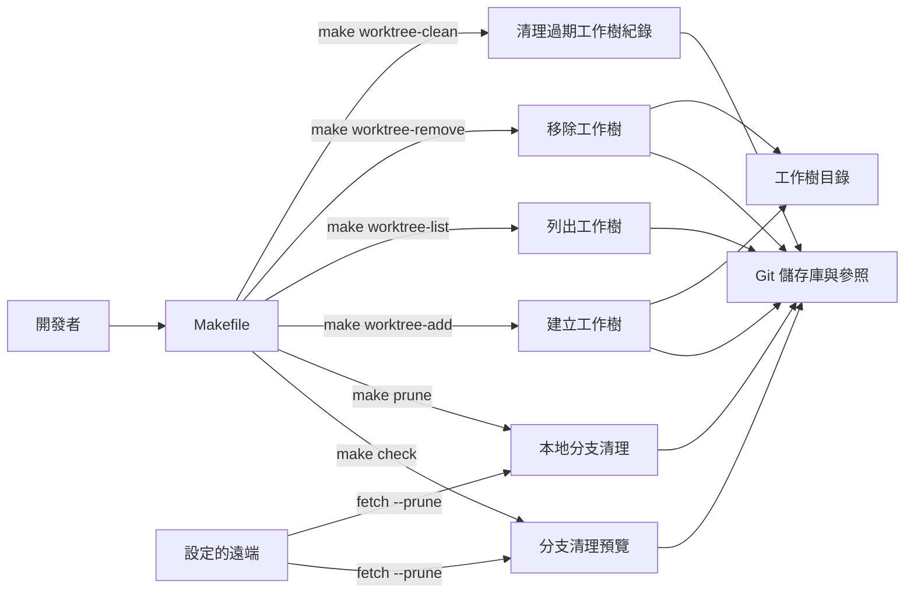
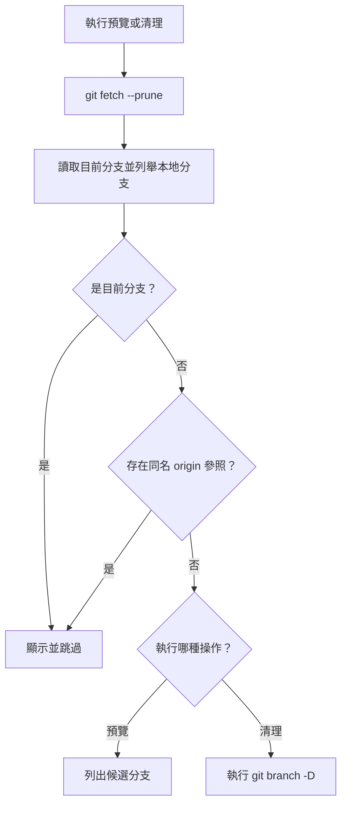
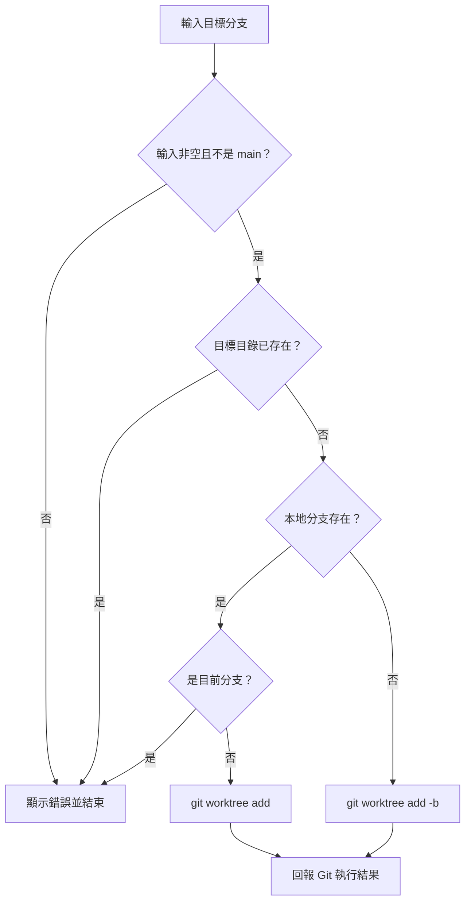
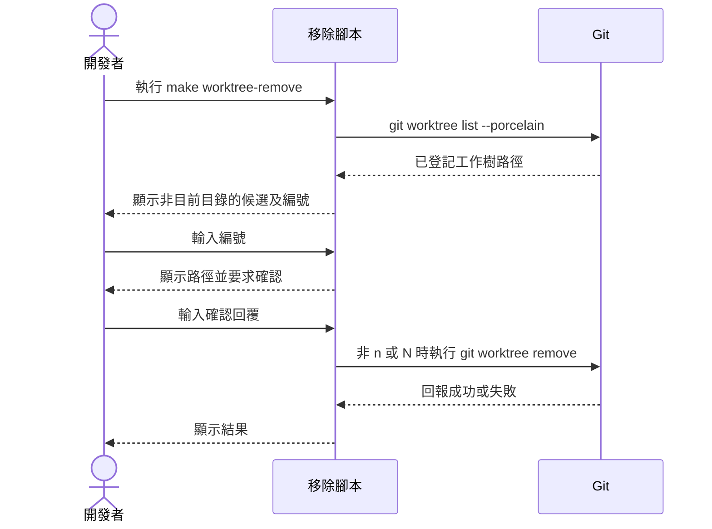

# Git 分支與工作樹管理

本模組提供六支手動執行的 zsh 腳本，協助開發者預覽及清理本地分支，並建立、列出、移除或清理 Git worktree。這些工具操作開發者的 Git 儲存庫與檔案系統，不參與 WeaMind LINE Bot 的執行期處理。其他工具見[維運與開發腳本](../operational_and_development_scripts.md)。

## 架構與操作入口

`Makefile` 將每個目標對應到一支獨立腳本；腳本之間不互相呼叫，而是透過 Git 共用的分支參照和 worktree 資訊產生關聯。以下命令以儲存庫根目錄為工作目錄，需安裝 `make`、`zsh`、`git` 及腳本使用的 `grep`、`head`、`cut`。分支清理還需要可存取設定的遠端。

| 入口 | 腳本 | 效果 |
| --- | --- | --- |
| `make check` | `scripts/cleanup_local_branches_preview.sh` | 更新遠端追蹤參照並列出清理候選，不刪除本地分支 |
| `make prune` | `scripts/cleanup_local_branches.sh` | 更新遠端追蹤參照，強制刪除符合條件的本地分支 |
| `make worktree-add` | `scripts/worktree_add.sh` | 互動輸入分支，建立工作樹；必要時建立本地分支 |
| `make worktree-list` | `scripts/worktree_list.sh` | 顯示 `git worktree list` 結果 |
| `make worktree-remove` | `scripts/worktree_remove.sh` | 互動選擇並移除工作樹 |
| `make worktree-clean` | `scripts/worktree_clean.sh` | 執行 `git worktree prune` 清理過期紀錄 |

入口定義見 `Makefile`；其他建置與部署目標見[建置、部署與設定](../build_deployment_and_configuration.md)。

## 預覽與清理本地分支

兩支分支腳本先執行 `git fetch --prune`，再以 `git rev-parse --abbrev-ref HEAD` 取得目前分支，並列舉 `git branch --format='%(refname:short)'` 的本地分支。它們跳過目前分支，對其他分支檢查 `refs/remotes/origin/<branch>` 是否存在。預覽腳本列出缺少同名參照的分支；清理腳本則對每個候選執行 `git branch -D`。

建議先執行 `make check`，逐一確認候選及是否需要保留，再決定是否執行 `make prune`。兩次執行都會重新 fetch、重新計算清單，故預覽不會鎖定後續刪除集合。

- 判斷條件是 `origin` 上的**同名遠端追蹤參照**，不是分支設定的 upstream，也不檢查是否已合併。僅存在於本地、使用其他遠端或追蹤不同名稱的分支都可能成為候選。
- `git branch -D` 允許刪除尚未合併的分支，腳本沒有逐一確認或備份。Git 仍可能拒絕刪除已在其他 worktree 簽出的分支。
- `git fetch --prune` 本身會更新並清理遠端追蹤參照，因此 `make check` 也會改變本地 Git 參照。腳本沒有設定 `set -e`，fetch 失敗後仍可能繼續使用既有參照判斷；執行前後應留意 fetch 與各個刪除命令的輸出，不能只依靠最後的結束狀態判定整批成功。

## 建立工作樹

執行 `make worktree-add` 後，腳本先顯示 `git branch -a` 中符合 `feature/`、`hotfix/`、`bugfix/` 的前十行，供輸入參考；這份清單不是允許建立的完整分支清單。

- 路徑固定由目前工作目錄組合成 `../WeaMind-$TARGET_BRANCH`。例如 `feature/location-settings` 對應 `../WeaMind-feature/location-settings`，斜線會形成子目錄。
- 空輸入、`main`、已存在的目標目錄，以及與目前分支相同的既有本地分支會被腳本拒絕。腳本只預先檢查目標是否為目錄；其他路徑衝突交由 Git 回報。
- 既有本地分支使用 `git worktree add "$WORKTREE_PATH" "$TARGET_BRANCH"`。如果該分支已由另一個 worktree 使用，Git 可能拒絕；腳本只先比對目前分支。
- 本地分支不存在時使用 `git worktree add -b "$TARGET_BRANCH" "$WORKTREE_PATH"`，未指定起點，從目前 `HEAD` 建立；即使存在同名遠端分支，也不會由腳本指定以該遠端分支為起點。
- 成功時腳本顯示 `cd` 路徑，但不會替目前 shell 切換目錄。失敗時檢查 Git 的錯誤訊息及檔案系統狀態。

## 列出、移除與清理工作樹

`make worktree-list` 直接執行 `git worktree list`，供開發者查看已登記的工作樹、提交與分支。

`make worktree-remove` 從 `git worktree list --porcelain` 擷取 `worktree` 路徑，將與 `pwd` 完全相同的路徑排除，列出其餘項目並要求輸入編號。無候選或編號不合法時退出；選擇後再次提示確認，只有輸入 `n` 或 `N` 會取消，包含空白輸入在內的其他回覆都會執行 `git worktree remove "$SELECTED_WORKTREE"`。成功移除工作樹不會自動刪除其分支。

篩選依據只是路徑字串與 `pwd` 的比較，並非辨識或保護主要工作樹；從其他工作樹或子目錄執行時，清單可能包含主要工作樹或目前工作樹。選擇前應核對完整路徑。腳本使用命令輸出建立 zsh 陣列，含空白的路徑可能被拆分，應避免依賴其選單處理這類路徑。Git 可能拒絕移除有未提交或未追蹤內容的工作樹；腳本不使用 `--force`，應先檢查並保存需要的內容。

`make worktree-clean` 執行 `git worktree prune` 清理 Git 認定過期的工作樹管理紀錄；它與移除工作樹目錄或刪除本地分支是不同操作。腳本依 Git 命令結果回報成功或失敗，沒有額外指定保留期限或互動確認。

## 建議操作順序

1. 以 `make worktree-list` 查看目前登記狀態，再用 `make worktree-add` 建立所需工作樹。
2. 完成工作後，確認工作樹內的變更已妥善處理，再使用 `make worktree-remove` 並核對選取路徑。若有過期紀錄，可使用 `make worktree-clean`。
3. 如需清理本地分支，先執行 `make check` 檢查候選與 fetch 結果，再視需要執行 `make prune`；完成後重新檢查分支狀態。

這些步驟是人工操作建議，腳本不會自動串接、備份或回滾。若要匯出分支文件，另見[文件維護工具](documentation_utilities.md)。
