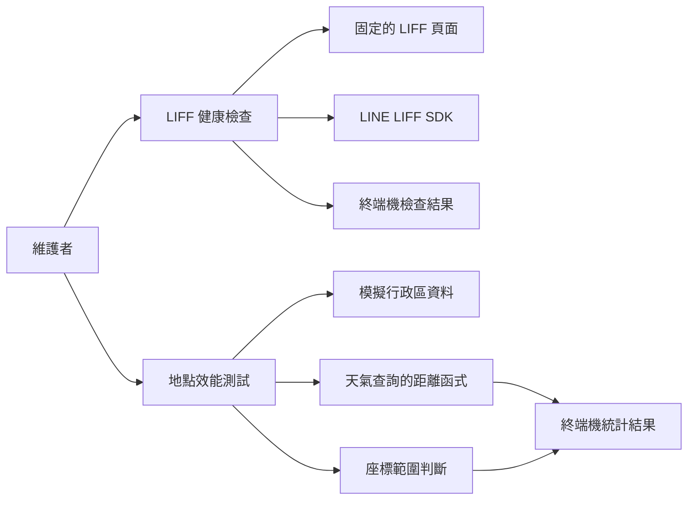
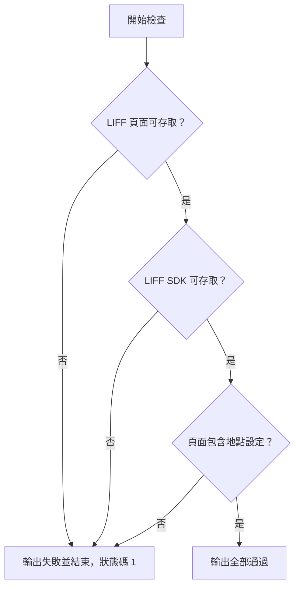
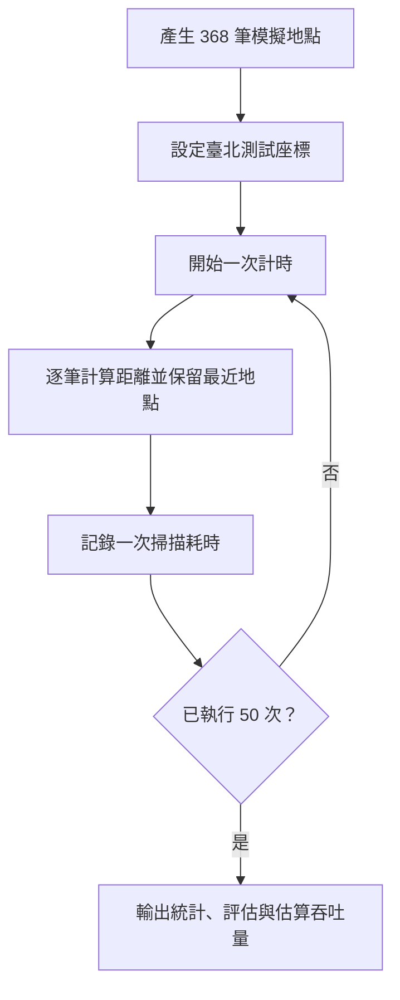

# 健康與效能檢查

本模組提供兩支獨立診斷腳本：`scripts/check_liff_health.sh` 檢查固定 LIFF 頁面、LINE LIFF SDK 的可存取性與頁面文字；`scripts/performance_test.py` 使用模擬地點量測距離計算與臺灣座標範圍判斷。前者需要網路，後者在本機執行，兩者都在終端機輸出結果。

## 架構與系統關係



LIFF 頁面與使用者地點設定流程見 [LIFF 地點設定](../users_and_location_settings/users_and_location_settings_liff.md)；正式地點解析與天氣查詢見 [天氣查詢](../weather_queries.md)。這兩支腳本屬於[維運與開發腳本](../operational_and_development_scripts.md)，並不互相呼叫。

## 執行方式

在專案根目錄執行：

```bash
bash scripts/check_liff_health.sh
uv run python scripts/performance_test.py
```

健康檢查需要 Bash、`curl`、`grep` 與可連線至目標網址的環境；網址寫死在腳本中，沒有命令列參數或環境變數可切換。效能測試需要專案 Python 環境及匯入 `app.weather.location_resolution` 所需的依賴；腳本將專案根目錄加入 `sys.path`。目前 `Makefile` 和 `.github/workflows/ci.yml` 沒有直接執行這兩支腳本的步驟，相關設定見 [建置與部署設定](../build_deployment_and_configuration.md)。

## LIFF 健康檢查

腳本依序執行三項檢查，任何一項失敗就輸出失敗訊息並以狀態碼 `1` 結束；全部通過時輸出成功訊息並正常結束。

| 順序 | 目標與判斷 | 失敗時的檢查方向 |
| --- | --- | --- |
| 1 | 使用 `curl -f -s -o /dev/null` 請求 `https://api.kyomind.tw/static/liff/location/index.html`。 | 檢查網路、網域、TLS、服務與頁面回應。 |
| 2 | 以相同方式請求 `https://static.line-scdn.net/liff/edge/2/sdk.js`。 | 檢查到 LINE SDK 網址的連線與回應。 |
| 3 | 再次請求 LIFF 頁面，以 `grep -q "地點設定"` 搜尋回應內容。 | 檢查頁面內容、文字是否變更及請求是否成功。 |



前兩次請求的 `curl -f` 會讓 HTTP 4xx、5xx 視為失敗；腳本未指定重新導向、重試或逾時選項。第三次是獨立請求，使用 `curl -s` 而非 `-f`，管線的判斷取決於 `grep` 是否找到文字，因此即使錯誤回應含有該文字也可能通過。檢查未執行 JavaScript、登入或地點設定操作，也未驗證 SDK 功能，不能單憑通過結果認定完整使用流程正常。

## 地點效能測試

### 模擬資料與距離計算

`MockLocation` 是含 `full_name`、`latitude`、`longitude` 的 `NamedTuple`。`generate_mock_taiwan_locations()` 從腳本內建的行政區座標樣本產生五組帶有小幅經緯度偏移與名稱字尾的資料，再取前 368 筆；這些資料用於模擬運算量，並非完整的正式行政區資料。

`test_haversine_performance()` 以 `(25.0478, 121.5170)` 為測試座標，執行 50 次完整掃描。每次以 `time.perf_counter()` 計時，逐筆呼叫 `app.weather.location_resolution._distance`，保留距離最小的地點；該函式以 Haversine 公式計算公里距離。每隔 10 次輸出一次耗時與最近地點，最後列出平均數、中位數、最小值、最大值和樣本標準差，單位皆為毫秒。



腳本依平均耗時分為小於 1 ms、小於 5 ms、小於 15 ms，以及 15 ms 以上四個評估區間，並以 `1000 / avg_time` 估算每秒可執行的完整掃描次數。這是依平均單次計算耗時推算的數值，不是並行負載測試的實測吞吐量；超過評估門檻只會輸出警告，不會因此使腳本失敗。

正式程式的 `_from_coordinates` 還會檢查座標範圍、查詢資料庫中有經緯度的 `Location`，並只接受 15 公里內的最近地點。效能腳本未測量資料庫、網路、完整請求或該距離門檻，也不驗證正式流程的正確性。

### 臺灣座標範圍檢查

`test_taiwan_bounds_performance()` 對臺北、高雄、東京、馬尼拉四組座標分別執行五批測量，每批重複 1,000,000 次比較：

```python
21.9 <= lat <= 26.5 and 118.0 <= lon <= 122.0
```

它輸出每組座標的內外判斷，以及五批平均耗時換算出的每次微秒數。此處的比較式與目前正式程式相同，但腳本直接複製判斷邏輯，未呼叫正式的座標解析函式；修改正式邊界時應一併檢查此腳本。此矩形範圍是初步篩選，並非精確的地理邊界。

## 結果判讀與限制

效能測試的計時受執行環境、系統負載與 Python 環境影響，適合在條件相近時比較變更前後結果。腳本會印出固定的正面結論，但沒有依測量結果斷言服務符合延遲目標；應以實際統計值及正式環境量測判斷。執行期間若發生例外，腳本輸出錯誤和 traceback，並以狀態碼 `1` 結束；正常執行完畢則以狀態碼 `0` 結束。
