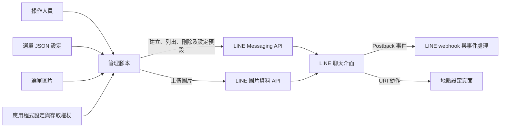
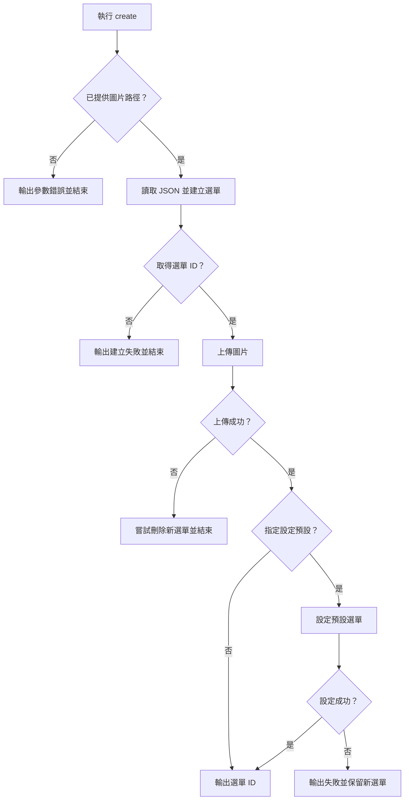

# LINE 圖文選單管理

此模組以 `scripts/rich_menu_manager.py` 管理 WeaMind LINE Bot 的 Rich Menu：建立選單、上傳圖片、選擇性設為預設、列出及刪除。它是由操作人員執行的管理腳本；使用者點選選單後，LINE 平台再將 Postback 事件交給應用程式，或開啟設定中的 URI。

## 架構與系統關係



腳本透過 `httpx.Client` 直接呼叫 LINE API，並從 `app.core.config.settings` 取得 `LINE_CHANNEL_ACCESS_TOKEN`。設定載入與其他必要環境變數見[應用程式核心](../application_core.md)；Webhook 和 Postback 處理分別見 [LINE webhook](../line_bot/line_bot_webhook.md) 與 [Postback 處理](../line_bot/line_bot_postback.md)，地點頁面見 [LIFF 地點設定](../users_and_location_settings/users_and_location_settings_liff.md)。腳本本身不處理使用者的查詢或 webhook。

## 設定與輸入

- `docs/rich_menu/rich_menu_config.json`：由 `load_rich_menu_config()` 以 UTF-8 讀取，內容直接作為建立選單的 JSON。路徑由腳本位置推導，不取決於執行時目錄。
- 圖片：`create` 的 `--image` 指定本機檔案。腳本註解要求 PNG、大小不超過 1 MB，尺寸為 2500×1686 或 2500×843；腳本只檢查檔案是否存在，未驗證格式、尺寸或大小，並固定以 `image/png` 上傳。
- 憑證：`Settings` 從環境或目前工作目錄的 `.env` 讀取設定。除了 `LINE_CHANNEL_ACCESS_TOKEN`，初始化 `Settings` 仍需要其餘必填欄位，包括 `LINE_CHANNEL_SECRET` 和 PostgreSQL 設定；詳見 `app/core/config.py`。請勿將權杖寫進文件或命令列。
- 執行環境：`pyproject.toml` 宣告 Python 3.12 以上、`httpx` 和 `pydantic-settings`；專案使用 `uv` 管理環境。

目前的 JSON 定義 2500×1686、預設展開的兩列三欄選單，聊天欄文字為「選單」：

| 位置 | 動作 | 設定值 |
| --- | --- | --- |
| 左上 | 查住家天氣 | `action=weather&type=home` |
| 中上 | 查公司天氣 | `action=weather&type=office` |
| 右上 | 最近查過的地點 | `action=recent_queries` |
| 左下 | 開啟地點設定 | `https://api.kyomind.tw/static/liff/location/index.html` |
| 中下 | 依地圖查詢天氣 | `action=weather&type=current` |
| 右下 | 更多資訊 | `action=other&type=menu` |

五個 Postback 區域的 `data` 是與應用程式的介面；修改時應同步確認 [Postback 處理](../line_bot/line_bot_postback.md)。左下區域使用 URI，網址直接寫在 JSON 中，不會由 `BASE_URL` 動態產生。圖片上的視覺區域應與 JSON 的 `bounds` 一致。

## 操作流程

在專案根目錄準備環境與設定後執行：

```sh
uv run python -m scripts.rich_menu_manager list
uv run python -m scripts.rich_menu_manager create --image docs/rich_menu/rich_menu.png
uv run python -m scripts.rich_menu_manager create --image docs/rich_menu/rich_menu.png --set-default
uv run python -m scripts.rich_menu_manager delete --rich-menu-id MENU_ID
```

`create` 必須提供 `--image`；只有加上 `--set-default` 才會設定預設選單。成功時輸出新選單 ID，應保留此 ID 供後續查詢與清理。`delete` 必須提供 `--rich-menu-id`，刪除無法復原；先用 `list` 確認目標。設定新預設會取代原本的預設選單。



上傳失敗時的刪除只是一次嘗試，刪除也可能失敗，應檢查日誌並用 `list` 確認。設定預設失敗後，已建立且附有圖片的選單仍在 LINE 平台上；CLI 不會印出該 ID，但建立時的日誌會記錄它。

## API 與函式

| 函式 | 請求或用途 | 回傳 |
| --- | --- | --- |
| `load_rich_menu_config()` | 讀取並解析設定檔 | 設定字典 |
| `create_rich_menu()` | `POST /v2/bot/richmenu`，送出 JSON | `richMenuId` 或 `None` |
| `upload_rich_menu_image()` | `POST /v2/bot/richmenu/{rich_menu_id}/content`，送出圖片位元組至 `api-data.line.me` | 成功為 `True`，否則為 `False` |
| `set_default_rich_menu()` | `POST /v2/bot/user/all/richmenu/{rich_menu_id}` | 成功為 `True`，否則為 `False` |
| `list_rich_menus()` | `GET /v2/bot/richmenu/list` | `richmenus` 清單；HTTP 錯誤時為空清單 |
| `delete_rich_menu()` | `DELETE /v2/bot/richmenu/{rich_menu_id}` | 成功為 `True`，否則為 `False` |

除圖片上傳使用 `https://api-data.line.me`，其餘請求使用 `https://api.line.me`；每次操作都以 Bearer 權杖授權。各 API 操作建立獨立的 `httpx.Client`，並以 `raise_for_status()` 檢查 HTTP 狀態。

## 更新與故障處理

LINE 選單建立後不能修改 JSON 設定；要變更區域、動作或其他設定，需建立新選單並視需要切換預設。圖片可獨立更新，但目前 CLI 沒有只更新圖片的動作；程式提供 `upload_rich_menu_image(rich_menu_id, image_path)` 供程式呼叫。腳本文件記載每個帳號最多 1000 個 Rich Menu，舊選單可在確認後刪除。

HTTP 錯誤會記錄例外並轉成上述回傳值。`list` 的空清單同時代表沒有選單或 HTTP 請求失敗，因此畫面顯示「沒有找到 Rich Menu」時也要查看日誌。缺少圖片會回報上傳失敗；設定檔不存在、JSON 無效、圖片讀取失敗、設定初始化失敗或回應 JSON 格式異常等非 `httpx.HTTPError` 例外則可能直接終止程式。腳本以一般 `return` 結束多數失敗分支，不能只靠程序結束碼判斷操作成功。

相關腳本的整體索引見[操作與開發腳本](../operational_and_development_scripts.md)。
