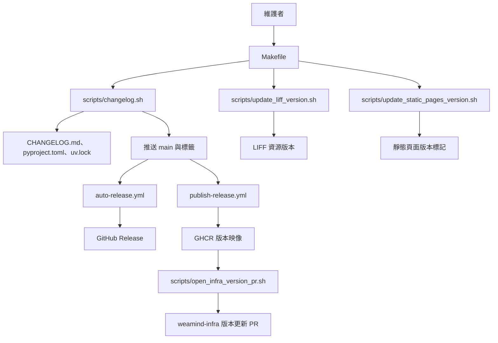
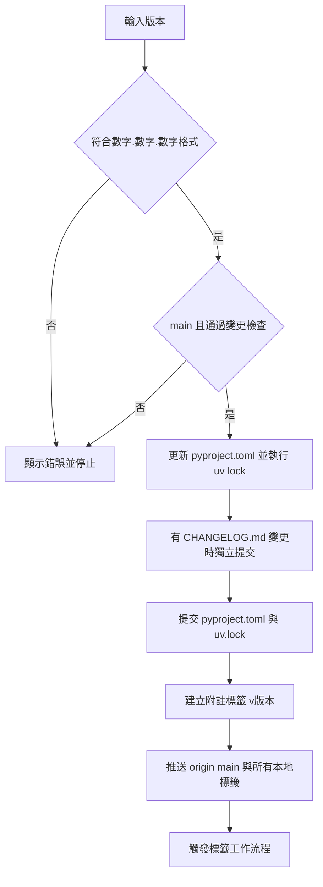
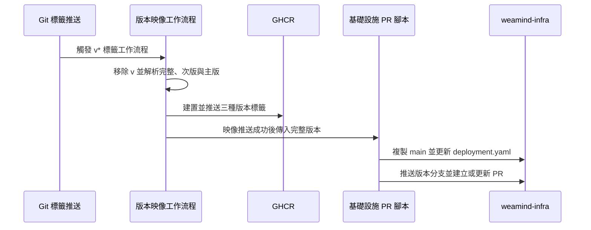

# 發布與版本管理

本模組以四支腳本維護 CHANGELOG、發布應用程式版本、提出基礎設施映像更新，以及更新前端版本標記。應用程式版本與頁面時間戳各自獨立；更新頁面標記不會執行部署。

## 架構與系統位置

`Makefile` 是本機入口。`.github/workflows/auto-release.yml` 與 `.github/workflows/publish-release.yml` 分別由 `v*` 標籤推送觸發：前者建立附自動產生說明的 GitHub Release，後者建置版本映像並在推送成功後呼叫基礎設施 PR 腳本。兩個工作流程彼此獨立，沒有互相等待的順序保證。`latest` 映像由 `.github/workflows/publish-ghcr.yml` 管理。詳見[建置與部署自動化](../build_deployment_and_configuration/build_deployment_and_configuration_automation.md)及[容器與部署設定](../build_deployment_and_configuration/build_deployment_and_configuration_containers.md)。

## 操作入口

下列指令從儲存庫根目錄執行；`Makefile` 以 `zsh` 呼叫腳本。

| 指令 | 用途與副作用 |
| --- | --- |
| `make changelog-status` | 顯示分支、最近標籤、目前版本及其後的 commits。 |
| `make changelog-prepare VERSION=0.2.0` | 檢查分支與已追蹤檔案的變更，列出 commits 和撰寫提示；`VERSION` 可省略，僅供顯示。 |
| `make changelog-release VERSION=0.2.0` | 更新版本與鎖定檔、建立 commits 和標籤，並推送到 `origin`。 |
| `make changelog-help` | 顯示精簡操作說明。 |
| `make update-liff-version` | 更新 LIFF HTML 資源查詢參數與 JavaScript 註解。 |
| `make update-static-version` | 更新靜態頁面的 `cache-version` 中繼標籤。 |

`scripts/changelog.sh` 另提供 `prepare [version]`、`update <version>`、`release <version>`、`status`、`help`、`guide` 和 `quick-help`。`release` 先確認有指定版本，再交給 `update_version`；`update` 直接進入同一函式，仍會檢查參數與版本格式。

## CHANGELOG 與應用程式發布

### 準備內容

1. 執行 `make changelog-status` 了解目前版本與變更。
2. 在 `main` 且已追蹤檔案沒有未提交變更時，執行 `make changelog-prepare`。腳本透過 `git describe --tags --abbrev=0` 找到目前提交可達的最近標籤，列出該標籤至 `HEAD` 的 commit 訊息，並輸出供 Copilot Chat 使用的繁體中文 CHANGELOG 提示。
3. 人工整理並編輯 `CHANGELOG.md`，再執行發布指令。腳本不會自行產生或驗證 CHANGELOG 內容。

找不到標籤時腳本使用 `v0.1.0` 作為回退值；若該標籤實際不存在，相關 Git 範圍查詢可能失敗，狀態顯示的零筆結果不能證明沒有變更。`git diff-index` 和發布用的 `git diff` 不列出未追蹤檔案，操作前仍應檢查完整工作目錄。

### 發布流程

版本格式限制為 `X.Y.Z` 數字格式，不接受字首 `v`、預發布或建置字尾。發布檢查要求位於 `main`，預期只允許 `CHANGELOG.md` 有已追蹤變更；若 CHANGELOG 沒有變更，程式碼設計為詢問是否繼續。實作以 `echo "$changed_files"` 計算其他檔案數量：當清單完全為空時，空行也會被計數，因此可能在詢問前誤報其他變更。檢查不涵蓋未追蹤檔案。

更新 `pyproject.toml` 後執行 `uv lock`；若 CHANGELOG 有差異，先建立獨立的 CHANGELOG commit，再提交版本檔案、建立附註標籤，最後執行 `git push origin main --tags`。此推送包含所有尚未推送的本地標籤，並非僅限新標籤。腳本使用 macOS 形式的 `sed -i ''`，需有 Git、`uv`、可寫入檔案及可推送的遠端權限。

操作不是交易式：`uv lock`、提交、標籤或推送失敗時，先前修改不會自動復原。推送失敗時本機 commits 和標籤仍存在；應先檢查 `git status`、提交、標籤及遠端狀態，再決定如何復原或補推。指令成功只表示推送完成，後續工作流程、PR 合併與部署需另外確認。

## 映像與基礎設施版本交接

例如 `v1.2.3` 產生 `1.2.3`、`1.2`、`1` 三個 GHCR 標籤；工作流程使用 `Dockerfile` 建置 `linux/amd64` 與 `linux/arm64` 映像。`scripts/open_infra_version_pr.sh` 接收不含 `v` 的版本，要求 `GH_TOKEN`，工作流程以 `WEAMIND_INFRA_PR_TOKEN` 提供。腳本檢查 `gh`、`git`、`sed`、`grep`、`mktemp`，並使用 `awk` 和 `head`。

腳本複製 `kyomind/weamind-infra` 的 `main` 到暫存目錄，將 `manifests/deployment.yaml` 中符合 `ghcr.io/kyomind/weamind:<tag>` 的文字替換成完整版本，提交至 `bump-weamind-<version>` 並以 `--force-with-lease` 推送。PR 內包含原映像、新映像與 Release 連結；已有同分支的開啟中 PR 時更新，否則建立新 PR。若 manifest 沒有差異則直接結束，也不更新既有 PR；此情況可能是版本已相同，也可能是替換樣式未匹配，應檢查檔案。暫存目錄在結束時清除。

此腳本只提出 PR，不會合併或自行驗證部署。Release 工作流程彼此獨立，因此 PR 中的 Release 連結在建立當下可能尚未就緒。

## 前端資源版本

### LIFF

`scripts/update_liff_version.sh` 以執行環境的本地時間產生 `YYYYMMDD-HHMM`，替換 `static/liff/location/index.html` 中既有的 `style.css?v=...`、`app.js?v=...`，並更新 `static/liff/location/app.js` 的 `// AUTO_UPDATE_VERSION:` 註解，最後以 `grep` 顯示結果。查詢參數改變會改變資源 URL，提供瀏覽器重新請求資源的方式；註解本身不是快取控制。LIFF 內容詳見[位置設定前端](../users_and_location_settings/users_and_location_settings_liff.md)。

腳本依賴既有文字格式與 macOS `sed -i ''`，未加入缺少的資源引用或註解，也沒有 `set -e`。同一分鐘內重複執行會產生相同時間戳。執行後應檢查實際差異，依環境重新建置或部署；腳本只提示使用 `make dev-up` 或 `make up`，不會自行執行。

### 靜態頁面

`scripts/update_static_pages_version.sh` 使用相同時間戳處理 `static/announcements/index.html`、`static/help/index.html`、`static/about/index.html`：存在 `cache-version` 字串時替換符合固定格式的 meta 標籤，否則嘗試在 `<meta charset="UTF-8">` 後加入。不存在的檔案會顯示警告並跳過；輸出的完成訊息和重複的驗證區塊不能證明每個檔案都已修改。

這支腳本只修改 HTML 中繼資料，不會修改資源 URL、HTTP 快取標頭或部署頁面；單憑 meta 標籤不能保證瀏覽器快取失效。請檢查檔案差異、實際部署及回應快取策略。替換依賴精確的 HTML 格式，若文字存在但格式不同，也可能未產生變更。

## 相關文件

- [操作與開發腳本](../operational_and_development_scripts.md)：其他維護工具的總覽。
- [建置、部署與設定](../build_deployment_and_configuration.md)：專案的建置及設定入口。
- [建置與部署自動化](../build_deployment_and_configuration/build_deployment_and_configuration_automation.md)：GitHub Actions 的觸發與工作內容。
- [容器與部署設定](../build_deployment_and_configuration/build_deployment_and_configuration_containers.md)：映像及容器設定。
