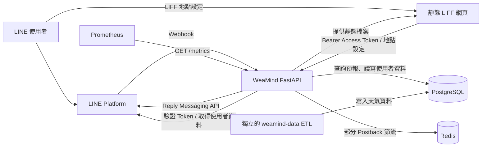
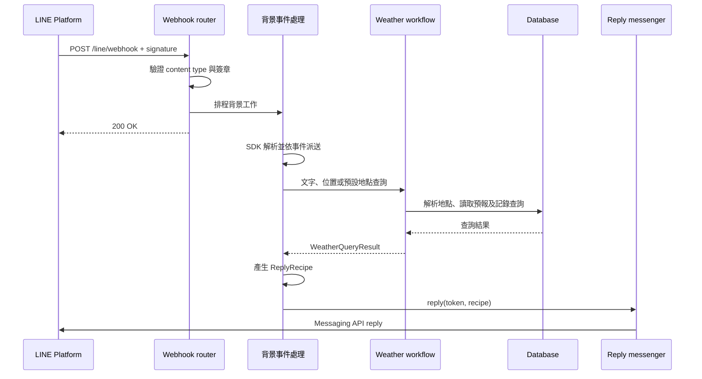
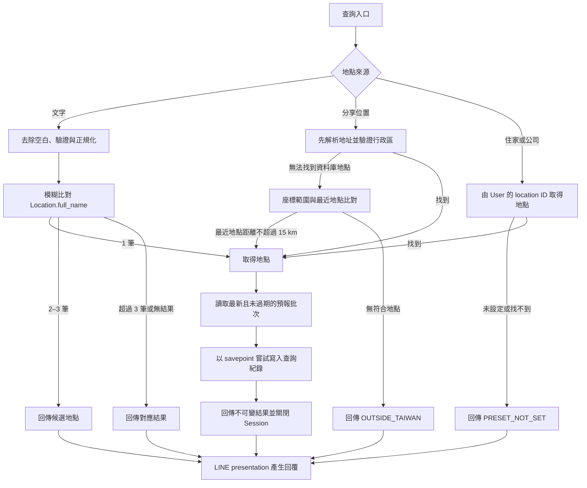
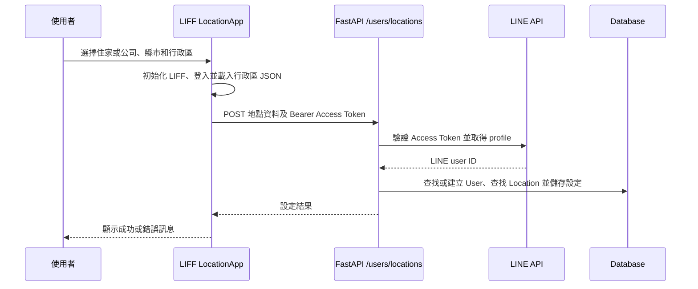
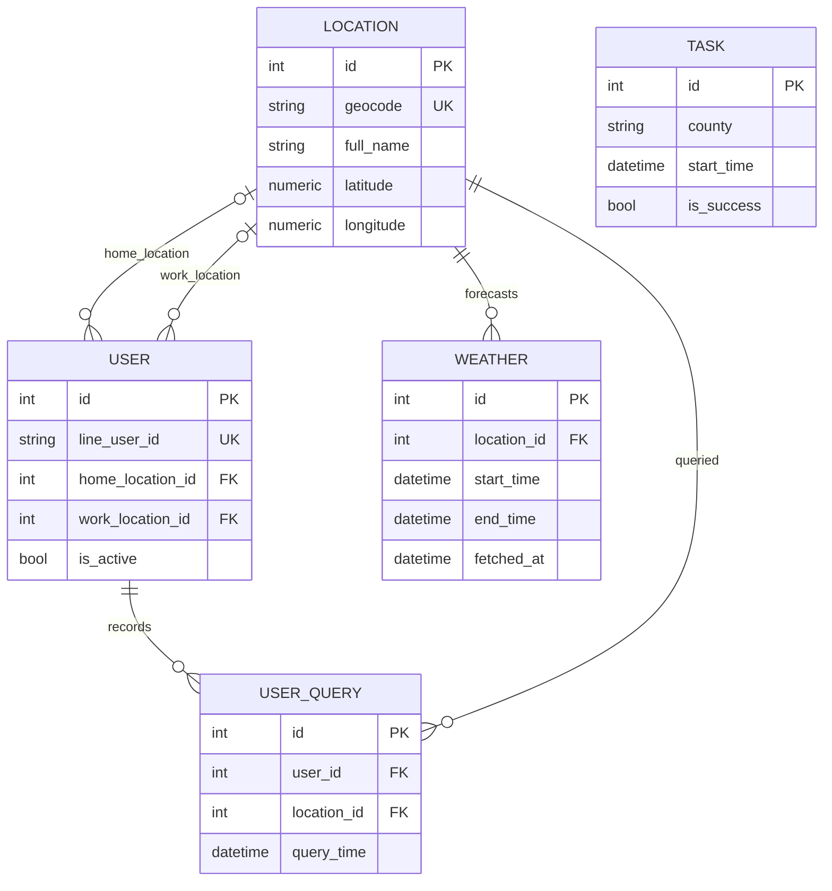

# WeaMind 系統文件

WeaMind 是以 LINE Bot 為主要介面的台灣天氣查詢服務。本儲存庫的 FastAPI 應用程式負責接收 LINE 事件、解析查詢地點、讀取預報，以及管理使用者的常用地點和查詢紀錄。獨立的 `weamind-data` 元件負責天氣資料的 ETL；兩者透過資料庫銜接。本文以目前程式碼為準，涵蓋應用程式及其外部依賴。

## 系統架構

| 元件 | 職責 | 主要程式 |
| --- | --- | --- |
| 應用程式入口 | 初始化日誌與行政區、註冊路由、提供靜態檔案和監控端點 | `app/main.py` |
| LINE 介面 | 驗證 webhook、派送事件、處理 Postback、組裝及傳送回覆 | `app/line/` |
| 天氣查詢 | 解析地點、管理查詢交易、讀取預報 | `app/weather/` |
| 使用者 | 管理使用者、常用地點與最近查詢 | `app/user/` |
| 共用基礎設施 | 設定、資料庫 session、驗證、行政區與處理鎖 | `app/core/` |
| LIFF | 讓登入的使用者選擇住家或公司地點 | `static/liff/location/` |

程式結構與系統邊界另見 [Architecture.md](../Architecture.md) 和 [Tree.md](../Tree.md)。

## LINE Webhook 與事件處理

`POST /line/webhook` 先檢查 JSON content type，以 channel secret 計算 HMAC-SHA256 並驗證 `X-Line-Signature`，記錄接收指標後安排 FastAPI background task，回傳 `{"message":"OK"}`。背景工作使用 LINE SDK 再解析並派送各事件；此回覆只代表請求已被接受，不代表後續查詢或 LINE 回覆成功。背景工作發生例外時會記錄日誌。`LineSdkWebhookDispatcher` 封裝 SDK handler 查找與呼叫，包括對 SDK 私有介面的依賴，升級 SDK 時應一併檢查。

文字與位置訊息分別呼叫 `query_text` 和 `query_shared_location`。追蹤事件建立或重新啟用使用者，取消追蹤則將使用者標記為非活躍；未支援的事件交給預設 handler。`process_webhook_events` 在事件層記錄處理成功、錯誤及耗時，解析失敗時使用 router 預先分類的事件類型。部分 handler 與傳送介面會自行捕捉錯誤，因此事件處理成功指標不等同使用者已收到回覆。

### Postback 與處理鎖

`prepare_postback` 將 rich menu 的 query string 轉為不可變的 `PostbackPlan`；`execute_postback` 執行動作並回傳一份回覆配方。

| 動作 | 行為 | 需要處理鎖 |
| --- | --- | --- |
| `weather` / `home` 或 `office` | 查詢使用者的住家或公司預報 | 是 |
| `weather` / `current` | 請使用者分享位置 | 否 |
| `settings` / `location` | 回傳 LIFF 設定頁連結 | 否 |
| `recent_queries` | 顯示最近查詢地點 | 是 |
| `other` / `menu` | 提供更新、使用說明與專案資訊連結 | 否 |
| 無效動作或類型 | 回傳對應的提示 | 否 |

處理鎖以 LINE user ID 建立 `processing:user:<id>`，Redis 使用 `SET NX EX` 原子取得鎖；預設 TTL 為 1 秒，時間到期後自動解除，不在處理完成時主動釋放。鎖被佔用時回覆操作過於頻繁；Redis 未設定、連線或操作失敗時採 fail-open，允許請求繼續。鎖是短時間節流，並非保證處理期間互斥或事件去重。文字和分享位置查詢不經此 Postback 鎖。

## 天氣查詢流程

### 地點解析

- **文字**：先去除首尾空白，限 2–7 個中文字，將「台」轉為「臺」，再以 `Location.full_name` 包含比對並依名稱排序。1 筆直接查詢；2–3 筆提供選擇；超過 3 筆要求更具體的地名；0 筆回報找不到。
- **分享位置**：優先從地址擷取縣市與行政區，使用 `static/data/tw_admin_divisions.json` 驗證完整行政區名稱，再查找資料庫。失敗時先檢查座標是否位於緯度 21.9–26.5、經度 118.0–122.0 的矩形範圍，接著以 Haversine 距離尋找最近的有座標地點；超過 15 公里或找不到地點則回傳 `OUTSIDE_TAIWAN`。這個結果也涵蓋範圍內但沒有足夠近的資料，並非精確的國界判斷。
- **預設地點**：`query_preset` 僅接受 `home` 或 `office`；後者對應資料庫的 `work_location_id`。使用者或地點不存在時回傳 `PRESET_NOT_SET`。

行政區管理器在初始化時將 JSON 展開為完整名稱集合；檔案不存在或載入失敗會記錄錯誤並使用空集合，使地址驗證失敗，但座標備援仍可運作。

### 預報與交易邊界

`WeatherService.get_weather_forecast_by_location` 選取該地點在目前 UTC 時間前 6.5 小時內最新的 `fetched_at` 批次，篩除 `end_time` 已到的時段，依 `start_time` 排序並最多回傳 8 筆。每筆資料模型代表 3 小時；8 筆是目標上限，資料不足時可能少於 8 筆，並不保證完整 24 小時。查詢例外會記錄日誌並回傳空清單，因此呼叫端的無預報結果也可能代表讀取失敗。

`workflow.py` 為每次查詢建立並管理 SQLAlchemy session 與交易，將 ORM 物件複製成 `ResolvedLocation`、`ForecastData` 和 `WeatherQueryResult`，使 presentation 層不依賴開啟中的 session。已解析地點且使用者存在時，以巢狀交易（savepoint）嘗試新增 `UserQuery`；紀錄失敗會記錄日誌，不應阻斷主要查詢。找不到使用者時不記錄歷史。

`QueryOutcome` 包含 `FORECAST`、`NO_WEATHER`、`MULTIPLE_LOCATIONS`、`TOO_MANY_LOCATIONS`、`LOCATION_NOT_FOUND`、`OUTSIDE_TAIWAN`、`INVALID_INPUT` 和 `PRESET_NOT_SET`。LINE presentation 根據結果及 `QueryKind` 選擇文字或候選按鈕；預報最多呈現 8 筆，將時間視為 UTC 並轉為台灣時間，缺少降雨機率時顯示 0%。

## LINE 回覆邊界

`ReplyMessenger` 是 `reply(reply_token, recipe) -> SendResult` 協定。呼叫端建立與 LINE SDK 無關的不可變配方，生產環境由 `LineSdkReplyMessenger` 轉換為 SDK 模型，測試可使用 `InMemoryReplyMessenger` 記錄回覆或模擬失敗。

| 配方 | 回覆內容 |
| --- | --- |
| `TextRecipe` | 純文字 |
| `MessageChoicesRecipe` | 文字與傳送訊息的 Quick Reply 選項 |
| `LocationRequestRecipe` | 文字與分享位置按鈕 |
| `UriChoicesRecipe` | 文字與開啟網址的 Quick Reply 選項 |

必要文字不得為空或只有空白；選項數須為 1–13，URI 須為絕對 HTTP(S) 網址。缺少 reply token 回傳 `invalid_request`。SDK adapter 為每次回覆建立 client，且不重試；`SendResult` 將失敗分類為 `invalid_request`、`authentication`、`rate_limited`、`line_api`、`transport` 或 `internal`，避免讓 SDK 例外穿透此邊界。

## 使用者與 LIFF 地點設定

前端從靜態 JSON 載入縣市與行政區，驗證選項後送出 `location_type`（`home` 或 `work`）、`county`、`district`。後端使用 LINE Access Token 驗證及 profile API 取得 user ID，再依縣市和行政區查找已儲存的 `Location`；無效類型或找不到地點回傳 HTTP 400。登入失效時前端重新導向 LINE 登入。`app/core/auth.py` 另有 ID Token 驗證功能，但此設定端點使用 Access Token。

最近查詢由 `UserQuery` 按時間倒序讀取，排除目前的住家和公司、按地點去重，最多回傳 5 個；實作只檢視最近 100 筆紀錄。使用者尚不存在時，最近查詢動作會先建立使用者。

## 資料模型與依賴

`Weather` 以地點、起訖時間及 `fetched_at` 的組合約束唯一性；`Task` 記錄獨立 ETL 的執行狀態和統計。`app/core/database.py` 根據設定建立 engine 與 `SessionLocal`，FastAPI 的 `get_session` dependency 在請求結束後關閉 session。SQLite 使用 `StaticPool` 與 `check_same_thread=False`；一般設定使用 PostgreSQL。

## 設定與操作

`Settings` 從環境變數及 `.env` 讀取設定；必填項目包括 `POSTGRES_USER`、`POSTGRES_PASSWORD`、`POSTGRES_HOST`、`POSTGRES_DB`、`LINE_CHANNEL_SECRET`、`LINE_CHANNEL_ACCESS_TOKEN`。`DATABASE_URL` 若有設定會優先作為連線網址；否則由 PostgreSQL 欄位組成。其他常用設定包括 `ENV`、`DEBUG`、`BASE_URL`、`REDIS_URL`、`PROCESSING_LOCK_ENABLED` 和 `PROCESSING_LOCK_TTL_SECONDS`。LIFF 前端的 API 與行政區資料網址在 `static/liff/location/app.js` 中設定，部署到其他網域時須一併檢查。

`GET /health` 回傳應用程式狀態，`GET /metrics` 提供 Prometheus 指標；health endpoint 不會測試資料庫或 Redis。開發環境啟用 FastAPI 文件，其他環境關閉 OpenAPI 文件端點。應用程式將日誌寫至 stdout 與 `logs/app.log`。

測試與檢查從儲存庫根目錄執行：`uv run pytest`、`uv run ruff check .`、`uv run pyright .`。`scripts/performance_test.py` 使用模擬地點測量距離計算與座標範圍檢查，不包含資料庫或端到端請求成本；`scripts/check_pip_audit_ignores.py` 掃描 GHSA 忽略項並查詢 GitHub Advisory，當 advisory 已撤回或出現修補版本時回傳非零狀態以提醒維護者評估。
