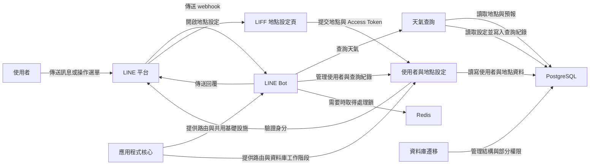

# WeaMind 專案概覽

WeaMind 透過 LINE Bot 提供天氣查詢服務。使用者可傳送地點文字、分享位置，或使用預設的住家與公司地點查詢天氣；LIFF 頁面則提供地點設定介面。本儲存庫的 FastAPI 應用程式負責 LINE 互動、使用者設定，以及讀取資料庫中的預報。

## 系統架構

LINE webhook 通過入口驗證後，應用程式會排程背景事件處理並回傳 HTTP 200；後續查詢與訊息傳送的結果另行記錄。天氣查詢從資料庫讀取預報，預報資料的產製不屬於本儲存庫的查詢流程。

## 核心模組

- [應用程式核心](application_core.md)：組裝 FastAPI 路由，提供設定、資料庫工作階段、LINE 身分驗證、行政區資料與 Redis 處理鎖。
- [LINE Bot](line_bot.md)：處理 webhook、事件分派、選單動作與訊息回覆。
- [使用者與地點設定](users_and_location_settings.md)：管理使用者、預設地點、查詢紀錄與 LIFF 設定頁。
- [天氣查詢](weather_queries.md)：解析文字、分享位置或預設地點，並讀取近期預報。
- [資料庫遷移](database_migrations.md)：以 Alembic 管理資料庫結構及部分角色權限。
- [維運與開發腳本](operational_and_development_scripts.md)：提供發布、安全稽核、健康檢查、文件與 Git 管理等工具。

## 建置與執行

專案使用 `uv` 管理 Python 依賴，以 `Dockerfile` 打包應用程式，並透過 Compose 執行應用程式、PostgreSQL 與 Redis。CI 執行程式碼品質、安全與測試檢查，並驗證容器映像建置；發布流程將映像推送至 GHCR，部署流程則啟動服務並嘗試執行資料庫遷移。設定與操作細節見[建置、部署與設定](build_deployment_and_configuration.md)及[資料庫遷移](database_migrations.md)。
