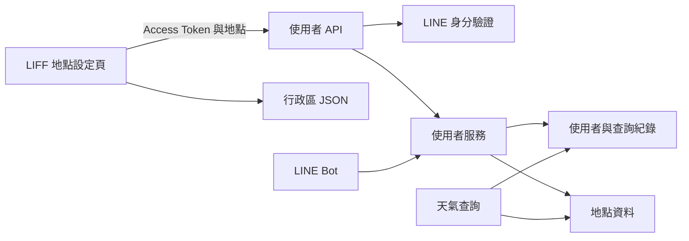

# 使用者與地點設定

此模組管理 LINE 使用者、住家與公司預設地點，以及最近查詢紀錄。LIFF 地點設定頁透過 API 儲存使用者選擇，LINE Bot 與天氣查詢流程則使用這些資料。

## 架構概覽

使用者資料以 LINE user ID 對應帳號，住家和公司分別透過外鍵參照共用的 `Location`。LINE Bot 管理追蹤狀態及最近查詢選單；天氣查詢讀取預設地點，也會直接建立查詢紀錄。系統邊界與依賴可參考[應用程式核心](application_core.md)、[LINE Bot](line_bot.md)、[天氣查詢](weather_queries.md)與[資料庫遷移](database_migrations.md)。

## 子模組

| 文件 | 職責 |
| --- | --- |
| [使用者與地點設定後端](users_and_location_settings/users_and_location_settings_backend.md) | 說明使用者和查詢紀錄模型、地點設定 API、服務邏輯及交易邊界。 |
| [LIFF 地點設定頁面](users_and_location_settings/users_and_location_settings_liff.md) | 說明登入、行政區資料載入、表單操作、API 提交及錯誤處理。 |

## 主要資料流程

1. LINE Bot 提供地點設定頁面連結。LIFF 頁面載入行政區清單，供使用者選擇住家或公司及縣市、行政區。
2. 頁面將選擇與 LINE Access Token 送至 `POST /users/locations`。後端驗證身分與地點類型，依縣市和行政區查詢資料庫，並更新使用者的地點外鍵。
3. 天氣預設查詢讀取使用者地點。設定 API 使用 `home` 與 `work`，天氣預設查詢使用 `home` 與 `office`；`work` 和 `office` 對應同一個 `work_location_id`。
4. 天氣查詢在解析出地點且找到使用者時寫入 `UserQuery`；LINE Bot 的最近查詢選單讀取紀錄，排除目前住家及公司地點並依地點去重。

前端使用行政區 JSON 檢查選項，後端則以資料庫 `Location` 紀錄確認地點存在；兩份資料需要維持一致。
