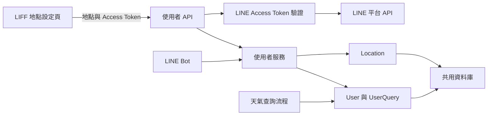
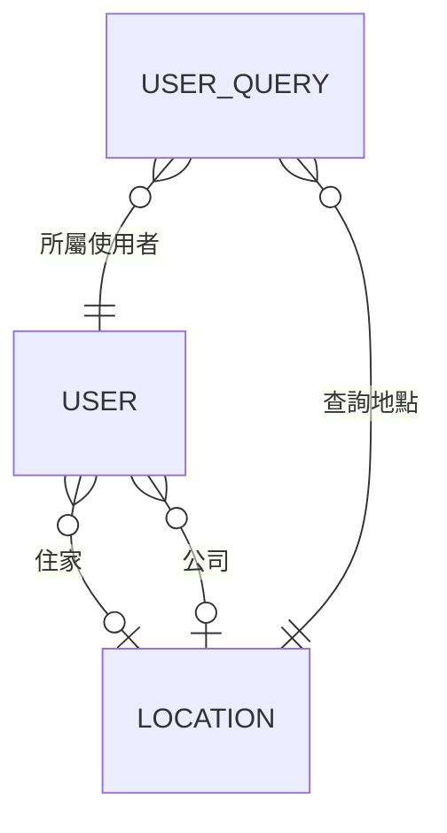
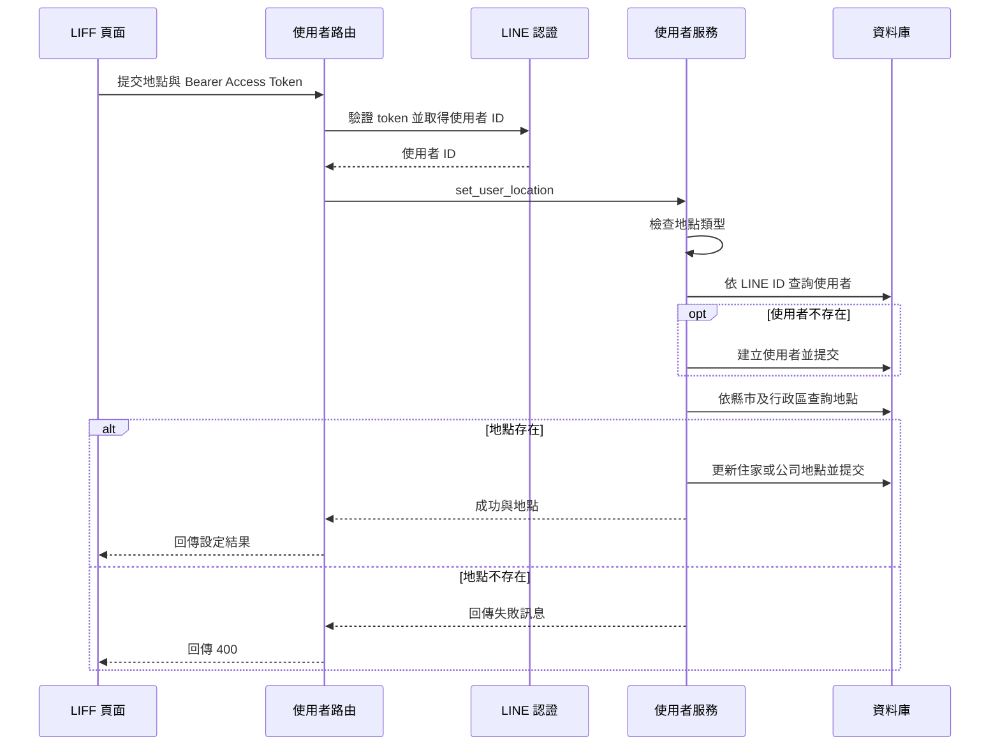

# 使用者與地點設定後端

此模組負責保存 LINE 使用者、住家與公司預設地點，以及地點查詢紀錄。它提供 LIFF 使用的地點設定 API，也提供服務函式給 LINE Bot 管理使用者狀態與讀取最近查詢。預設地點由天氣查詢流程使用。

## 在系統中的位置



`app/main.py` 註冊使用者路由；認證與資料庫 session 由[應用程式核心](../application_core.md)提供。前端操作見 [LIFF 地點設定](users_and_location_settings_liff.md)，LINE 事件及選單見 [LINE Bot](../line_bot.md)，預設地點的天氣查詢見[天氣查詢](../weather_queries.md)，資料表演進見[資料庫遷移](../database_migrations.md)。整體功能概覽見[使用者與地點設定](../users_and_location_settings.md)。

| 檔案 | 職責 |
| --- | --- |
| `app/user/__init__.py` | 宣告使用者管理套件。 |
| `app/user/router.py` | 定義 API、注入身分與 session，並轉換服務結果。 |
| `app/user/schemas.py` | 定義請求與回應的 Pydantic 模型。 |
| `app/user/service.py` | 管理使用者、預設地點及查詢紀錄。 |
| `app/user/models.py` | 定義 `User`、`UserQuery` 與 ORM 關聯。 |

## 資料模型



| 模型與欄位 | 用途與限制 |
| --- | --- |
| `User.id` | 自動遞增的內部主鍵。 |
| `User.line_user_id` | LINE 使用者 ID，具唯一性與索引。 |
| `User.home_location_id`、`User.work_location_id` | 可為空，分別參照 `location.id`；兩者可指向同一地點。 |
| `User.is_active` | 使用者啟用狀態，預設為 `True`。 |
| `User.created_at`、`User.updated_at` | 以 UTC 時間產生預設值；後者由 ORM 在更新時設定。 |
| `UserQuery.id` | 自動遞增的查詢紀錄主鍵。 |
| `UserQuery.user_id`、`UserQuery.location_id` | 必填外鍵，分別參照 `user.id` 與 `location.id`；前者有索引。 |
| `UserQuery.query_time` | 查詢時間，有索引，預設使用 UTC 時間。 |

`User.home_location`、`User.work_location`、`UserQuery.user` 和 `UserQuery.location` 使用 `lazy="select"`，存取關聯時才載入。地點本身由 `app.weather.models.Location` 定義。

## 地點設定 API

`POST /users/locations` 由 `app/user/router.py::set_user_location` 處理。呼叫端須在 `Authorization: Bearer <LINE Access Token>` 提供憑證；認證依賴向 LINE 驗證 token，再取得 profile 的 `userId` 作為 `line_user_id`。此路徑使用 Access Token，並非舊版 ID Token 驗證。實作檢查驗證回應中存在 `client_id` 和正數 `expires_in`，並未在此函式中比對 `client_id` 是否等於設定值。

請求 JSON 由 `LocationSettingRequest` 接收：

| 欄位 | 型別 | 說明 |
| --- | --- | --- |
| `location_type` | `str` | 服務層接受 `home` 或 `work`。 |
| `county` | `str` | 縣市名稱，例如「新北市」。 |
| `district` | `str` | 行政區名稱，例如「永和區」。 |

三個欄位都是必填字串；schema 本身沒有將 `location_type` 限制為列舉。成功時回傳 `LocationSettingResponse`，例如：

```json
{
  "success": true,
  "message": "住家地點設定成功",
  "location_type": "住家",
  "location": "新北市永和區"
}
```

公司設定的 `location_type` 為「公司」。`location` 由請求中的縣市與行政區直接串接；路由不使用服務回傳的 `Location` 物件產生回應。

| 結果 | HTTP 狀態與內容 |
| --- | --- |
| 設定成功 | `200`，回傳上述結構。 |
| 地點類型無效 | `400`，`detail` 為「無效的地點類型」。 |
| 查無縣市及行政區組合 | `400`，`detail` 為「地點不存在」。 |
| 請求欄位缺漏或型別不符 | FastAPI 請求驗證失敗，回傳 `422`。 |
| Access Token 無效或 LINE profile 無法取得有效使用者 ID | 認證函式回傳 `401`；缺少或不符合 Bearer 格式的憑證由 FastAPI 的 `HTTPBearer` 處理。 |
| 驗證 LINE API 時發生網路錯誤 | 認證函式回傳 `503`。 |

### 設定流程與交易邊界



服務先檢查 `location_type`，再依 LINE ID 查找使用者，最後以 `county` 和 `district` 的精確相等條件查詢 `Location`。新使用者的建立會先執行 `commit`；因此地點不存在而回傳失敗時，該使用者仍可能已建立。現有但停用的使用者在此流程中不會自動重新啟用，因為只有找不到使用者時才呼叫 `create_user_if_not_exists`。成功設定會更新對應外鍵、提交並重新整理使用者物件。

## 使用者生命週期

| 服務函式 | 行為 |
| --- | --- |
| `get_user_by_line_id` | 依 `line_user_id` 查詢第一筆使用者，找不到回傳 `None`。 |
| `create_user_if_not_exists` | 不存在時建立啟用使用者；已停用時重新啟用；已啟用時直接回傳。建立或重新啟用時提交並重新整理。 |
| `deactivate_user` | 找到使用者時將 `is_active` 設為 `False`、提交並重新整理；找不到回傳 `None`。資料與地點設定不會因此刪除。 |
| `get_location_by_county_district` | 依縣市及行政區查詢第一筆符合的 `Location`，找不到回傳 `None`。 |

LINE Bot 的追蹤事件使用建立或重新啟用函式；取消追蹤事件使用停用函式。最近查詢選單在找不到使用者時也會建立使用者。事件處理細節見 [LINE webhook](../line_bot/line_bot_webhook.md) 與 [LINE postback](../line_bot/line_bot_postback.md)。

## 查詢紀錄與最近地點

`record_user_query(session, user_id, location_id)` 新增一筆帶有目前 UTC 時間的 `UserQuery`，並立即提交。它接受內部使用者 ID 與地點 ID；此函式本身不負責解析地點或處理天氣結果。目前 `app/` 中沒有其他程式碼呼叫此函式。天氣查詢流程改由 `app/weather/workflow.py::_record_history` 直接新增 `UserQuery`：已解析出地點且找到使用者時，在巢狀交易中寫入；寫入失敗會記錄錯誤，不使天氣查詢失敗。

`get_recent_queries(session, user_id, limit=5)` 回傳 `Location` 清單：

1. 查詢使用者；不存在時回傳空清單。
2. 依 `query_time` 遞減查詢該使用者紀錄，排除目前設定的住家與公司地點。
3. 最多掃描符合條件的前 100 筆紀錄，依 `location_id` 去重，直到取得 `limit` 個地點。
4. 批次讀取對應的 `Location`，再依最近查詢順序排列；找不到的地點會被略過。

因此，即使較舊的紀錄含有其他地點，前 100 筆重複紀錄也可能使結果少於 `limit`。時間相同的紀錄沒有額外的排序鍵。`limit` 預設為 5，呼叫端應提供正整數；實作未明確驗證非正值。LINE postback 使用此函式呈現最近查詢地點，詳見 [LINE postback](../line_bot/line_bot_postback.md)。

## 維護與驗證

服務函式自行提交交易，呼叫端若需要將多項操作包成單一原子交易，必須考慮這些提交點。`get_session` 負責在請求結束後關閉 session，並未在相依函式中統一提交。使用者服務及 API 的測試位於 `tests/user/test_user.py`，包含建立與停用使用者、設定地點、認證失敗及最近查詢等情境；可在專案根目錄執行 `uv run pytest tests/user/test_user.py`。
