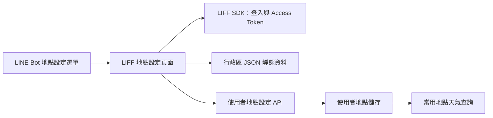
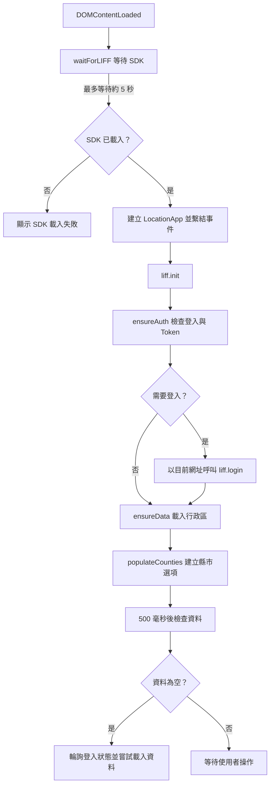
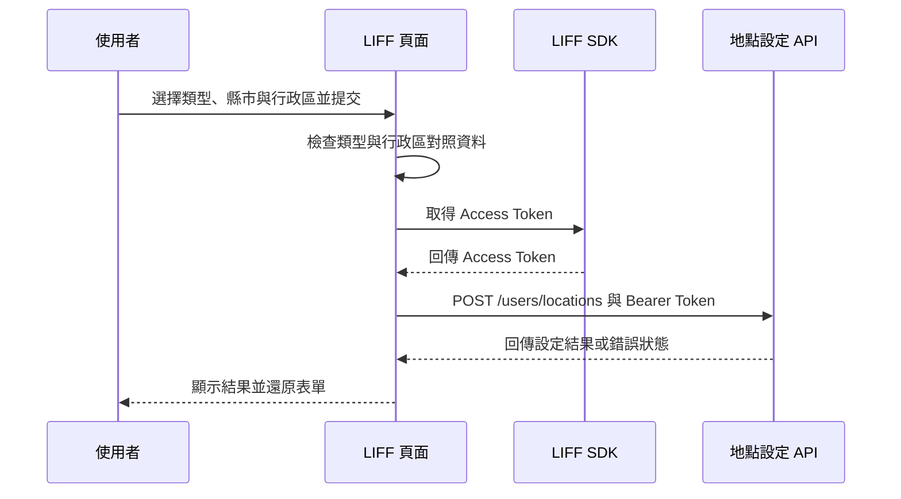

# LIFF 地點設定頁面

此模組提供 WeaMind 的住家與公司地點設定介面。`LocationApp` 在瀏覽器中初始化 LINE LIFF SDK、載入臺灣行政區資料、管理表單，並以 LINE Access Token 向後端提交選擇的地點。這些設定供 LINE Bot 的常用地點天氣查詢使用；使用者資料與儲存邏輯詳見[使用者與地點設定](../users_and_location_settings.md)及[後端模組](users_and_location_settings_backend.md)。

## 系統位置與依賴



LINE Bot 的選單動作會產生 `settings.BASE_URL` 下的 `/static/liff/location/index.html` 連結；FastAPI 在 `/static` 掛載靜態檔案。選單行為見 [LINE Bot postback](../line_bot/line_bot_postback.md)，天氣查詢見[天氣查詢模組](../weather_queries.md)。

| 元件 | 職責 |
| --- | --- |
| `static/liff/location/index.html` | 提供表單、訊息與載入狀態的 DOM，載入 LIFF SDK、`style.css` 和 `app.js`。 |
| `static/liff/location/app.js` | 以 `LocationApp` 協調登入、行政區資料、表單互動與 API 請求。 |
| `static/liff/location/style.css` | 提供頁面樣式。 |
| `static/data/tw_admin_divisions.json` | 提供縣市到行政區陣列的對照資料，前端透過固定的 API 網址取得。 |
| `POST /users/locations` | 驗證身分與輸入，儲存使用者選定的地點；細節見[後端模組](users_and_location_settings_backend.md)。 |

## 啟動、登入與資料載入



1. `waitForLIFF()` 每 100 毫秒檢查一次全域 `liff`，最多 50 次；逾時時直接在 `message` 顯示錯誤。`LocationApp` 建構時先繫結事件，再呼叫 `init()`。
2. `init()` 以程式內的 LIFF ID `2007938807-GQzRrDoy` 呼叫 `liff.init()`。`ensureAuth()` 檢查 `liff.isLoggedIn()` 與 `liff.getAccessToken()`，未登入、缺少 Token 或取用失敗時，以目前頁面網址作為 `redirectUri` 呼叫 `liff.login()`。
3. `ensureData()` 在 `adminData` 已有內容時直接結束，否則由 `loadAdminData()` 取得 `https://api.kyomind.tw/static/data/tw_admin_divisions.json`。資料必須是非空物件，且每個縣市的值都必須是非空陣列；載入或驗證失敗會向上拋出例外。`populateCounties()` 依 `localeCompare()` 排序縣市。
4. 初始化完成後延遲 500 毫秒檢查資料；若仍為空，`tryResumeFlowWithPolling()` 預設每 300 毫秒檢查登入與 Token，最多約 5 秒。登入完成後嘗試載入資料，逾時則顯示可重試的提示。

`ensureAuth()` 呼叫登入後只從自身結束，並不提供成功或失敗結果給呼叫者；若頁面尚未導向，呼叫端仍會繼續執行資料載入。此外，初始化發生例外時會顯示錯誤，該次 `init()` 不會排定上述延遲輪詢；使用者仍可透過縣市欄位觸發資料復原。

## 表單與狀態管理

| 狀態或方法 | 用途 |
| --- | --- |
| `adminData`、`hasAdminData()` | 保存行政區對照，判斷是否已有資料。 |
| `isInitialized`、`setupEventListeners()` | 避免重複繫結事件；此旗標只表示事件已繫結。 |
| `isLoadingAdminData` | 防止 `ensureDataLoaded()` 與 `forceRecover()` 重複啟動受此旗標保護的載入。 |
| `retryCount`、`maxRetries` | 記錄上述兩種復原方法的失敗次數，預設門檻為 2；成功後歸零。 |
| `updateDistricts()` | 根據所選縣市排序並填入行政區；沒有有效縣市時停用行政區欄位。 |
| `validateForm()` | 地點類型、縣市與行政區皆有值才啟用提交按鈕。 |
| `resetForm()` | 將類型重設為 `home`，清空縣市與行政區、停用行政區與提交按鈕並隱藏訊息；不會清除已載入的資料。 |

縣市欄位取得焦點時，`ensureDataLoaded()` 在資料缺失時嘗試重新驗證登入並載入。重試提示被選取時，`change` 事件呼叫 `forceRecover()`；兩次失敗後提示關閉重開或稍後再試。此門檻控制提示內容，並非所有重試路徑的硬性上限：欄位再次取得焦點且資料仍為空時仍會嘗試載入。程式也註明 `<option>` 的點擊事件在部分瀏覽器不可靠，因此實際重試依賴選單的 `change` 事件。

表單依賴 `index.html` 中的 `county`、`district`、`locationForm`、`cancelBtn`、`submitBtn`、`message`、`loading` 及 `locationType` 欄位。`cancelBtn` 實際執行清除，不會關閉視窗。選擇新縣市會重建行政區選項；選擇欄位改變後會重新檢查提交按鈕狀態。

## 提交流程與資料契約



`submitForm()` 先隱藏表單、顯示載入畫面，再檢查 `location_type` 是否為 `home` 或 `work`、縣市是否存在，以及行政區是否屬於該縣市。前端驗證後，從 LIFF 取得 Access Token，並發送 JSON：

```http
POST https://api.kyomind.tw/users/locations
Content-Type: application/json
Authorization: Bearer <accessToken>
```

```json
{
  "location_type": "home",
  "county": "臺北市",
  "district": "中正區"
}
```

後端成功回應包含 `success`、`message`、`location_type` 與 `location`。前端會解析 JSON，但成功訊息由選取的類型自行組成，並未使用回應欄位；使用者可繼續設定其他地點。前端驗證只能協助介面防呆，後端仍會驗證身分與地點，詳見[後端模組](users_and_location_settings_backend.md)。

## 錯誤處理與維護重點

| 情況 | 頁面行為 |
| --- | --- |
| SDK 無法載入或初始化失敗 | 顯示錯誤；初始化錯誤會依訊息中是否包含 `permission` 或 `network` 提供對應提示。 |
| 本地無法取得 Access Token | 顯示重新登入提示，立即以目前網址導向登入。 |
| API 回傳 `401` | 顯示登入過期訊息，約 2 秒後導向登入。 |
| API 回傳 `400` 或 `500` | 分別顯示資料格式錯誤或伺服器暫時無法服務，不顯示後端詳細錯誤。 |
| 其他非成功狀態或請求錯誤 | 顯示一般設定失敗訊息，或由 `handleError()` 顯示例外訊息。 |
| 行政區載入失敗或輪詢逾時 | 更新縣市提示，提供重試或稍後再試的提示。 |

提交完成或失敗都會在 `finally` 還原表單。`showMessage()` 對成功與錯誤訊息設定 5 秒隱藏，資訊訊息則為 3 秒；SDK 等待逾時的直接顯示路徑不使用此計時器。

維護時應留意 LIFF ID、行政區資料網址和 API 網址目前寫在 `app.js`，而頁面 DOM ID 與事件處理程式彼此相依。`index.html` 為 CSS 與 JavaScript 加上版本查詢參數；相關版本管理流程見[發布與版本管理](../operational_and_development_scripts/release_and_version_management.md)。
