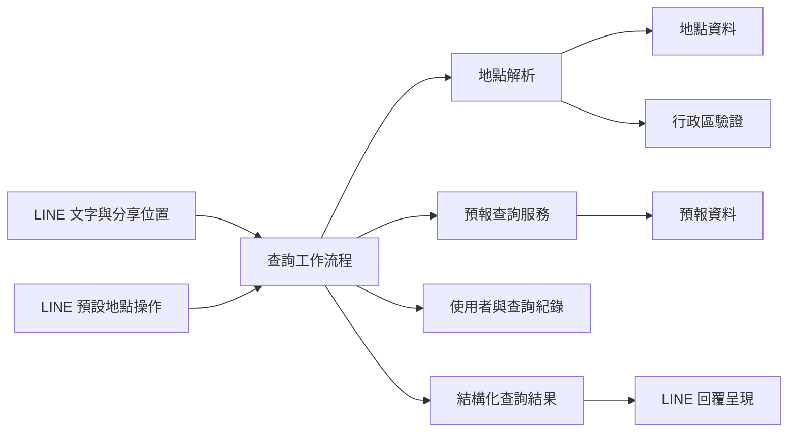
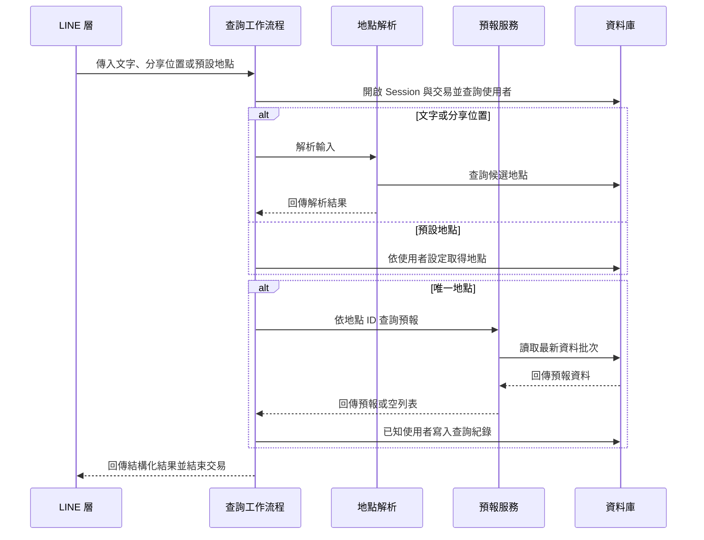
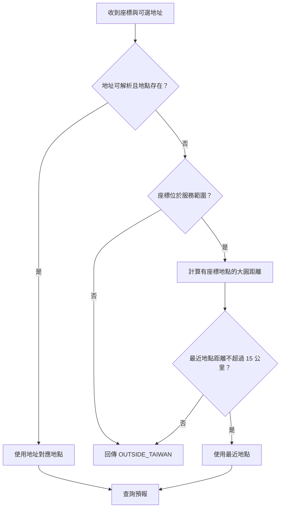
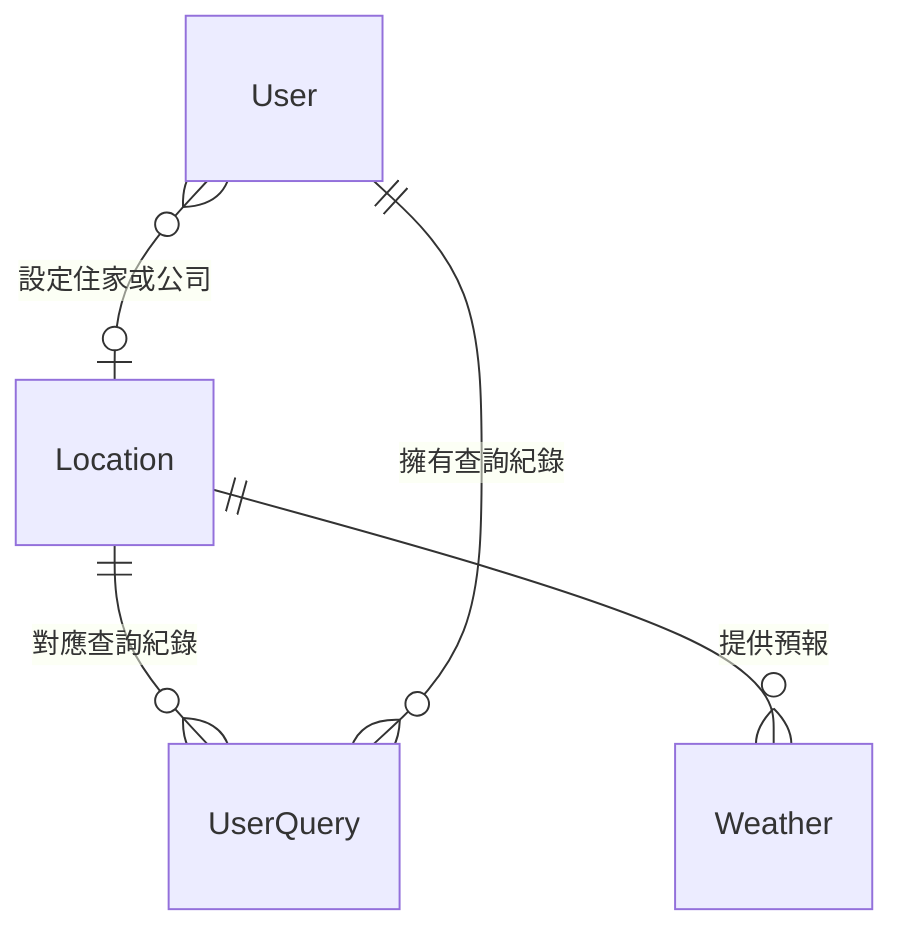

# 天氣查詢

天氣查詢模組將文字、分享位置或使用者預設地點解析為服務地點，讀取資料庫中的近期預報，並回傳不依賴 ORM 的結構化結果。LINE 層負責將結果轉成回覆；預報資料的產製則不在此模組的查詢流程中。

## 系統位置與元件

`app/weather/__init__.py` 是套件標記。其餘元件分工如下：

| 元件 | 職責 |
| --- | --- |
| `location_resolution.py` | 驗證文字、解析地址或座標，回傳地點與解析結果 |
| `workflow.py` | 管理查詢所需的 Session 與交易，協調地點解析、預報查詢及歷史紀錄 |
| `service.py` | 依地點讀取最新且尚在有效時間內的預報 |
| `models.py` | 定義地點、預報和資料處理任務的資料表模型 |

入口與回覆詳見 [LINE Bot](line_bot.md) 和 [LINE 回覆](line_bot/line_bot_replies.md)；使用者與預設地點詳見 [使用者與地點設定](users_and_location_settings.md)。Session、資料庫基礎及行政區資料請參考 [應用程式核心](application_core.md)；資料表演進請參考 [資料庫遷移](database_migrations.md)。

## 查詢入口與資料流

`workflow.py` 提供三個入口，均可透過關鍵字參數 `session_factory` 注入 Session 工廠；未指定時使用 `SessionLocal`。各入口自行開啟 Session 與交易，結束時離開對應的 context manager。

| 入口 | 輸入及處理 |
| --- | --- |
| `query_text(text, line_user_id)` | 查找使用者後解析文字；只有唯一地點才繼續查詢預報 |
| `query_shared_location(latitude, longitude, address, line_user_id)` | 查找使用者後優先解析地址，失敗時使用座標 |
| `query_preset(line_user_id, preset)` | `preset` 僅接受 `home` 或 `office`，分別使用使用者的 `home_location_id` 或 `work_location_id`；其他值會引發 `ValueError` |

文字與分享位置入口的 `line_user_id` 可為 `None`；查無使用者時仍可查預報，但不寫入查詢紀錄。預設地點入口若查無使用者、未設定地點或找不到對應地點，回傳 `PRESET_NOT_SET`。

### 文字地點解析

`resolve_text` 先去除前後空白，再依序檢查非空、長度為 2 至 7 個字，以及所有字元均落在 `[\\u4e00-\\u9fff]` 範圍。接著將「台」正規化為「臺」，對 `Location.full_name` 執行包含式 `LIKE` 查詢，並依完整名稱排序。

| 符合數量 | 結果 | 附帶資料 |
| --- | --- | --- |
| 0 | `LOCATION_NOT_FOUND` | 正規化文字 |
| 1 | 進入預報查詢 | 唯一地點 |
| 2 至 3 | `MULTIPLE_LOCATIONS` | 候選地點及正規化文字 |
| 超過 3 | `TOO_MANY_LOCATIONS` | 正規化文字，候選清單清空 |

驗證失敗回傳 `INVALID_INPUT`，其 `invalid_reason` 分別為 `EMPTY`、`INVALID_LENGTH` 或 `NON_CHINESE`。LINE 層可依候選地點建立選項，詳見 [LINE 回覆](line_bot/line_bot_replies.md)。

### 分享位置解析

地址解析以正規表示式擷取縣市與鄉鎮市區，將「台」換成「臺」，經 `is_valid_taiwan_division` 驗證後，以完整名稱精確查詢 `Location`。若地址缺失、無法匹配、驗證未通過或資料庫沒有該地點，改用座標。

座標備援先檢查緯度 `21.9–26.5`、經度 `118.0–122.0`，再逐一計算資料庫中具備經緯度的地點與輸入座標的大圓距離，取最近且距離不超過 15 公里的地點。找不到時回傳 `OUTSIDE_TAIWAN`；此結果也可能代表範圍內沒有足夠接近的服務地點。

## 預報讀取與歷史紀錄

`WeatherService.get_weather_forecast_by_location` 在一次呼叫中取得目前 UTC 時間，選出該地點 `fetched_at` 不早於目前時間減 6.5 小時的最新批次。接著只取該批次中 `end_time` 晚於目前時間的資料，依 `start_time` 升冪排列，最多取 8 筆。每筆模型代表一個 3 小時預報時段；這個上限旨在提供 24 小時預報，但資料不足時不保證有 8 筆或連續時段。

查無符合條件的資料時回傳空列表；查詢發生例外時服務記錄例外並同樣回傳空列表。工作流程將非空結果標為 `FORECAST`，空結果標為 `NO_WEATHER`，因此呼叫端無法僅憑此結果區分無資料與讀取例外。

確定地點後，即使沒有預報，工作流程仍會嘗試為已知使用者寫入 `UserQuery`。寫入使用巢狀交易的 savepoint 並執行 `flush`；失敗時記錄例外，不讓歷史紀錄的失敗破壞外層交易。無使用者時跳過此步驟。其他未在流程中處理的交易或資料庫例外不會轉成上述正常結果。

## 結果契約

`LocationResolution`、`ResolvedLocation`、`ForecastData` 和 `WeatherQueryResult` 均為不可變資料類別。工作流程將 ORM 物件所需欄位複製後回傳，讓 LINE 層不必持有開啟中的 Session。

- `ResolvedLocation` 包含 `id`、`full_name`。
- `ForecastData` 包含 `start_time`、`end_time`、`fetched_at`、`weather_emoji`、`precipitation_probability`、`max_temperature`。
- `WeatherQueryResult` 包含 `outcome`、`locations`、`forecast`、`query_text`、`invalid_reason`；`selected_location` 只有在 `locations` 恰有一筆時回傳該地點。

| `QueryOutcome` | 意義 |
| --- | --- |
| `FORECAST` | 地點已確定且取得至少一筆預報；在地點解析階段也用來表示已找到唯一地點 |
| `NO_WEATHER` | 地點已確定，但預報服務回傳空列表 |
| `MULTIPLE_LOCATIONS` | 文字符合 2 至 3 個地點 |
| `TOO_MANY_LOCATIONS` | 文字符合超過 3 個地點 |
| `LOCATION_NOT_FOUND` | 文字沒有符合的地點 |
| `OUTSIDE_TAIWAN` | 分享位置無法透過地址或座標找到服務地點 |
| `INVALID_INPUT` | 文字未通過格式檢查 |
| `PRESET_NOT_SET` | 使用者或指定預設地點不存在 |

## 資料模型

- `Location`：儲存唯一 `geocode`、縣市、行政區、具索引的 `full_name`、可選座標及建立與更新時間；透過 `forecasts` 關聯預報。
- `Weather`：以 `location_id` 關聯地點，儲存預報起訖、取得時間、天氣狀況、表情、降雨機率、最低與最高溫及原始描述。降雨機率受 0 至 100 約束；`location_id`、`start_time`、`end_time`、`fetched_at` 的組合唯一。
- `Task`：記錄 `weamind-data` ETL 的縣市、起訖時間、成功狀態、錯誤訊息、嘗試次數與處理筆數，供資料處理監控使用；本模組的查詢工作流程不讀取此表。

使用者與歷史資料的模型及設定流程另見 [使用者與地點設定後端](users_and_location_settings/users_and_location_settings_backend.md)。
